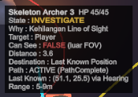

# Penjelasan Kode — Dungeon Hunter (Progress 2)

Dokumen ini menjelaskan kegunaan setiap class dan fitur yang sudah ada.
Semua script berada di `Assets/_DungeonHunter/`.

## Daftar isi

1. [Gambaran arsitektur](#1-gambaran-arsitektur)
2. [Core — sistem dasar game](#2-core--sistem-dasar-game)
3. [Player](#3-player)
4. [AI — inti mata kuliah](#4-ai--inti-mata-kuliah)
5. [Gameplay — objective](#5-gameplay--objective)
6. [DebugTools — AI Debug Mode](#6-debugtools--ai-debug-mode)
7. [Editor — pembuat scene](#7-editor--pembuat-scene)
8. [Ringkasan fitur](#8-ringkasan-fitur)

---

## 1. Gambaran arsitektur

Setiap frame, enemy menjalankan urutan berikut:

```text
Perception ──► Memory ──► Decision (FSM / Behavior Tree) ──► Navigation (NavMesh) + Steering (Separation)
```

Hubungan antar class:

```text
EnemyAI (abstract, FSM + Flee + Navigation)
 ├── MeleeEnemy     → Melee AI
 ├── RangedEnemy    → Ranged AI + Maintain Distance ──► Projectile
 └── GuardianEnemy  → Guardian Behavior ──► BehaviorTree (Selector, Sequence, Condition, Action)

EnemyAI memakai: AIPerception, AIMemory, Health, HitFlash, NavMeshAgent

ProximityInteractable (abstract)
 ├── KeyPickup
 ├── LockedDoor
 └── ArtifactPickup

Objek navigasi level: SpikeTrap (Area Cost), Portcullis (dynamic obstacle), NavMeshLink (balkon)
```

Struktur folder:

```text
Assets/_DungeonHunter/
├── Editor/
│   ├── DungeonSceneBuilder.cs
│   ├── KayKitImportSettings.cs
│   └── KayKitVisuals.cs
├── ThirdParty/KayKit/   model, animasi, tekstur KayKit (CC0)
├── Animation/           Animator Controller (dibuat otomatis oleh builder)
└── Scripts/
    ├── AI/          AIPerception, AIMemory, EnemyAI, MeleeEnemy, RangedEnemy, Projectile,
    │                BehaviorTree, GuardianEnemy
    ├── Core/        Health, NoiseSystem, HitFlash, CharacterAnimator, GameManager, GameHUD
    ├── DebugTools/  AIDebugManager, EnemyDebugVisual, NavigationDebugVisual
    ├── Gameplay/    ProximityInteractable, KeyPickup, LockedDoor, ArtifactPickup, Portcullis, SpikeTrap
    └── Player/      PlayerController, PlayerCombat, TopDownCamera
```

Peta level:


---

## 2. Core — sistem dasar game

### `Health`
`Scripts/Core/Health.cs`

Menyimpan HP. Dipakai oleh player dan enemy.

- `TakeDamage(jumlah, posisiSumber)` dan `Heal(jumlah)`
- Event `Damaged` dan `Died`, supaya class lain bisa bereaksi saat kena damage atau mati

### `NoiseSystem`
`Scripts/Core/NoiseSystem.cs`

Sistem suara untuk AI pendengaran (Hearing).

- Player memancarkan suara berupa posisi dan radius lewat `NoiseSystem.Emit(...)`
- Enemy yang berada di dalam radius itu akan "mendengar"

### `HitFlash`
`Scripts/Core/HitFlash.cs`

Feedback visual dengan mengubah warna badan sementara.

- Putih saat kena damage
- Dipakai juga sebagai tanda serangan enemy: **kuning** saat melee ancang-ancang, **oranye** saat archer membidik
- Memakai tint `_BaseColor` + `_EmissionColor`, supaya tetap terlihat pada model bertekstur

### `CharacterAnimator`
`Scripts/Core/CharacterAnimator.cs`

Penghubung antara logika (AI / player) dan Animator model KayKit.

| Parameter Animator | Sumber |
|---|---|
| `Speed` | Dihitung dari perpindahan posisi tiap frame → blend idle / jalan / lari |
| `Attack` | `PlayerCombat`, `MeleeEnemy` (saat windup), `RangedEnemy` (saat membidik), Guardian (Slam) |
| `Attack2` | Guardian (windup Charge) |
| `Taunt` | Guardian (Enrage / Phase 2) |
| `Hit` | Otomatis dari event `Health.Damaged` (Guardian tidak bereaksi agar serangannya tidak terputus) |
| `Dead` | Otomatis dari event `Health.Died` |

Karena kecepatan diambil dari perpindahan posisi, animasi tetap benar untuk NavMeshAgent,
CharacterController, lompatan NavMeshLink, maupun Charge Guardian.

### `GameManager`
`Scripts/Core/GameManager.cs`

Mengatur alur game.

- Status game: `Playing`, `Won`, `Lost`
- Progres objective: Key → pintu ruang Guardian → Guardian kalah → Artifact
- Event `KeyCollected` (dipakai gerbang besi untuk menutup)
- Teks objective dan pesan di layar
- Jumlah kill dan timer
- Tombol **R** untuk restart setelah menang atau kalah

### `GameHUD`
`Scripts/Core/GameHUD.cs`

Tampilan layar (sementara memakai IMGUI).

- Bar HP, objective, status Key, kill, waktu
- Pesan objective di tengah atas layar
- Layar berkedip merah saat player kena damage
- Bar HP kecil di atas enemy yang sudah terluka
- Layar **VICTORY** / **DEFEAT**

---

## 3. Player

### `PlayerController`
`Scripts/Player/PlayerController.cs`

- **WASD** untuk bergerak, **Shift** untuk sprint
- Karakter menghadap ke arah mouse
- Langkah kaki memancarkan suara:

| Gerakan | Radius suara |
|---|---|
| Jalan | 2.5 m |
| Sprint | 8 m |

Akibatnya, sprint lebih mudah ketahuan enemy.

### `PlayerCombat`
`Scripts/Player/PlayerCombat.cs`

- Serangan pedang dengan **klik kiri** atau **Space**
- Mengenai semua enemy dalam busur **120°** di depan, jangkauan **2.3 m**, damage **25**
- Ada animasi ayunan pedang
- Setiap serangan memancarkan suara (radius 9 m)

### `TopDownCamera`
`Scripts/Player/TopDownCamera.cs`

Kamera dari atas yang mengikuti player.

---

## 4. AI

### `AIPerception`
`Scripts/AI/AIPerception.cs`

"Sense" dari enemy.

**Penglihatan** dicek bertahap:

```text
1. Jarak     → apakah player di dalam view radius?
2. FOV       → apakah player di dalam sudut pandang?
3. Line of Sight → raycast, apakah terhalang dinding?
```

- Enemy lain tidak menghalangi pandangan

**Pendengaran**: menerima suara dari `NoiseSystem`.

### `AIMemory`
`Scripts/AI/AIMemory.cs`

Ingatan enemy.

- **Last Known Position** (posisi terakhir player yang diketahui)
- Kapan terakhir melihat player
- Sumber info: `Vision`, `Hearing`, atau `Damage`
- Ingatan otomatis hilang setelah 12 detik tanpa update

### `EnemyAI`
`Scripts/AI/EnemyAI.cs`

Class dasar (abstract) semua enemy, berupa **Finite State Machine**.

**State:**

| State | Arti |
|---|---|
| `Patrol` | Patroli waypoint. Kalau tidak punya waypoint, berjaga di pos sambil menoleh kiri-kanan |
| `Investigate` | Berjalan ke Last Known Position / sumber suara |
| `Search` | Mencari di titik-titik acak sekitar Last Known Position |
| `Chase` | Mengejar player yang terlihat |
| `Attack` | Menyerang |
| `Reposition` | Mundur untuk menjaga jarak |
| `Flee` | Kabur ke Retreat Point saat HP rendah, lalu regen |
| `Guard`, `Return`, `Enrage`, `Charge` | Khusus Guardian (diatur Behavior Tree) |
| `Dead` | Badan jatuh lalu dinonaktifkan |

**Perilaku umum:**

- Kalau diserang dari belakang, enemy langsung memeriksa arah datangnya serangan
- **Steering Separation**: enemy saling menjauh supaya tidak bertumpuk
- Menyimpan data untuk debug: State, `Reason` (alasan keputusan), tujuan gerak, dan path

**Flee / Retreat** (Melee & Ranged):

- Terpicu sekali saat HP ≤ **30%**, dari state apa pun
- Retreat Point dipilih berdasarkan **panjang path NavMesh** (bukan garis lurus): titik dianggap aman kalau path enemy ke sana lebih pendek daripada path player, lalu dipilih yang paling jauh dari player
- Sampai di titik aman → diam, menghadap player, regen **8 HP/detik**
- HP ≥ **70%** → kembali memburu (Investigate) kalau masih ingat LKP, kalau tidak → Patrol
- **Terpojok** (player < 2.2 m) → berhenti kabur dan melawan balik

**Navigation:**

| Fitur | Cara kerja |
|---|---|
| Area Cost | `agent.SetAreaCost(Trap, trapAreaCost)` per enemy: Melee 5, Archer 8, Guardian 1. Pathfinding menghindari jebakan selama jalan memutar lebih murah |
| NavMeshLink | `autoTraverseOffMeshLink = false`; saat agent tiba di link, enemy melompat sendiri dengan lintasan **parabola** lalu `CompleteOffMeshLink()` |
| Partial path | `pathStatus == PathPartial` → tujuan tidak bisa dicapai: berjalan ke ujung path (titik terdekat), menunggu 2 detik sambil menghadap tujuan, lalu Search |
| Panjang path | `PathLength(from, to)` menghitung panjang path NavMesh memakai area cost enemy tersebut (dipakai Flee) |
| Repath | Saat NavMesh berubah (gerbang menutup), NavMeshAgent otomatis menghitung ulang jalur |

### `MeleeEnemy`
`Scripts/AI/MeleeEnemy.cs`

**Melee AI** - Skeleton Warrior (×2).

- Mengejar player sampai jarak **1.8 m**, lalu menyerang
- Ancang-ancang **0.35 detik** (berkedip kuning) sebelum memukul
- Damage hanya masuk kalau player masih di depan dan masih dalam jangkauan, jadi serangannya bisa dihindari

FSM Melee:


### `RangedEnemy`
`Scripts/AI/RangedEnemy.cs`

**Ranged AI + Maintain Distance** - Skeleton Crossbowman (berjaga di balkon) dan Skeleton Mage.

Perilaku berdasarkan jarak ke player:

| Jarak ke player | State | Perilaku |
|---|---|---|
| > 9 m | `Chase` | Mendekat |
| 5–9 m | `Attack` | Berhenti, membidik 0.45 detik, lalu menembak |
| < 5 m | `Reposition` | Mundur sambil tetap menghadap player |

Cara memilih posisi mundur:

- Mengevaluasi **7 arah × 2 jarak langkah** di NavMesh
- Memilih titik yang paling jauh dari player dan bisa dicapai
- Sudut menyamping membuat archer bisa bergeser menyusuri dinding saat di pojok

Kalau tidak ada ruang untuk mundur, archer dianggap **terpojok**: tetap menembak, lalu mencoba mundur lagi setelah 2 detik.

FSM Ranged:


### `Projectile`
`Scripts/AI/Projectile.cs`

Panah / peluru archer.

- Bergerak lurus
- Menembus sesama enemy
- Hancur saat mengenai dinding
- Memberi damage ke player

### `BehaviorTree`
`Scripts/AI/BehaviorTree.cs`

Framework Behavior Tree kecil (materi Pertemuan 6).

| Node | Cara kerja |
|---|---|
| `BTSelector` | Coba child dari kiri ke kanan; berhenti di child pertama yang **Success** atau **Running** |
| `BTSequence` | Jalankan child berurutan; berhenti di child pertama yang tidak **Success** |
| `BTCondition` | Leaf yang mengecek kondisi → Success / Failure |
| `BTAction` | Leaf yang menjalankan perilaku → Success / Failure / Running |

`BTContext` mencatat **jalur node yang aktif** (contoh `Root > Ground Slam > Slam`) untuk ditampilkan di AI Debug Mode.

### `GuardianEnemy`
`Scripts/AI/GuardianEnemy.cs`

**Guardian Behavior** — Crypt Guardian (×1), boss penjaga Artifact. Turunan `EnemyAI`, tapi keputusannya memakai **Behavior Tree** (bukan FSM).


| Cabang | Kondisi | Aksi |
|---|---|---|
| Phase 2 | HP ≤ 50% dan belum enrage | **Enrage**: diam 1.2 detik, kecepatan ×1.4, cooldown slam ×0.7 |
| Leash | Player keluar arena (> 10 m dari pos) | **Kembali ke pos** + regen 15 HP/detik |
| Ground Slam | Jarak ≤ 2.6 m dan cooldown siap | Windup 0.8 detik (merah) → damage area 3 m, 25 damage |
| Charge | Phase 2, melihat player, jarak 4.5–10 m, cooldown siap | Windup 0.6 detik (oranye) → menerjang 0.8 detik, 20 damage |
| Kejar | Player / LKP berada di dalam arena | Kejar player atau menuju LKP |
| Jaga pos | — (fallback) | Berjaga di pos sambil melihat sekeliling |

- Enrage, Slam, dan Charge bersifat **committed**: sekali mulai, diselesaikan dulu
- Guardian tidak mengejar keluar arena, sehingga player bisa mundur untuk mengatur ulang posisi (tapi Guardian memulihkan HP)
- Area Trap cost 1 → Guardian tidak peduli jebakan

---

## 5. Gameplay

### `ProximityInteractable`
`Scripts/Gameplay/ProximityInteractable.cs`

Class dasar untuk objek yang aktif saat player mendekat (cek jarak, tanpa physics trigger). Juga membuat visualnya melayang dan berputar.

### `KeyPickup`
`Scripts/Gameplay/KeyPickup.cs`

Dungeon Key. Didapat begitu player mendekat.

### `LockedDoor`
`Scripts/Gameplay/LockedDoor.cs`

Pintu ruang Guardian (tempat Artifact).

- Tanpa Key: muncul pesan "Pintu terkunci"
- Dengan Key: pintu turun ke lantai dan NavMesh di situ terbuka (lewat `NavMeshObstacle` carve)
- Membuka pintu menimbulkan suara keras (radius 12 m)

### `ArtifactPickup`
`Scripts/Gameplay/ArtifactPickup.cs`

Ancient Artifact.

- **Tersegel** (lingkaran ungu) selama Guardian masih hidup
- Setelah Guardian kalah → diambil → **WIN**

### `Portcullis`
`Scripts/Gameplay/Portcullis.cs`

Gerbang besi antara hall dan ruang timur — **dynamic obstacle**.

- Awalnya terbuka
- Saat Key diambil (event `KeyCollected`), gerbang naik menutup jalur dan `NavMeshObstacle` (carve) aktif
- NavMesh berubah → semua enemy otomatis **repath** lewat koridor selatan
- Player juga harus keluar lewat koridor selatan

### `SpikeTrap`
`Scripts/Gameplay/SpikeTrap.cs`

Jebakan duri di tengah hall — **Area Cost**.

- Lantainya ditandai area NavMesh **`Trap`** (cost tinggi) lewat `NavMeshModifierVolume`, sehingga enemy memilih jalan memutar
- Siklus: diam 1.6 detik → peringatan 0.5 detik (duri muncul sedikit) → aktif 0.8 detik
- Saat aktif, melukai **siapa pun** di atasnya (15 damage), player maupun enemy

Alur gameplay:


---

## 6. DebugToolsMode

Tekan **F1** untuk menyalakan/mematikan.

### `AIDebugManager`
`Scripts/DebugTools/AIDebugManager.cs`

Menampilkan panel di atas setiap enemy, berisi:

- Nama dan HP
- **State** dan **Why** (alasan keputusan)
- Target
- **Can See**, beserta alasannya kalau tidak melihat
- Distance
- Destination
- Path (status + panjang path dalam meter)
- Nav: area NavMesh di bawah kaki (`Walkable` / `Trap`) atau `LOMPAT via NavMeshLink`
- Last Known Position beserta sumber infonya
- Saat Flee: Retreat Point yang dipilih beserta perbandingan panjang path enemy vs player
- Khusus Guardian: jalur node **Behavior Tree** yang aktif, Phase, dan jarak Leash

Contoh panel (screenshot dari game, tekan **F1**):



| Baris | Arti |
|---|---|
| `State : INVESTIGATE` | Archer sedang menuju posisi terakhir player |
| `Why : Kehilangan Line of Sight` | Alasan pindah state: player tadi terlihat lalu hilang dari pandangan |
| `Can See : FALSE (luar FOV)` | Player dalam radius pandang, tetapi di luar sudut pandang (FOV) archer |
| `Distance : 3.6` | Jarak ke player 3.6 m |
| `Destination : Last Known Position` | Tujuan gerak NavMesh adalah LKP |
| `Path : ACTIVE (PathComplete)` | Path NavMesh ke tujuan valid dan lengkap |
| `Last Known : (51.1, 25.5) via Hearing` | LKP terakhir diperbarui dari suara langkah player |
| `Range : 5-9m` | Zona Maintain Distance archer |

Ada juga legenda warna di pojok kiri bawah layar.

### `EnemyDebugVisual`
`Scripts/DebugTools/EnemyDebugVisual.cs`

Garis yang terlihat langsung di **Game view** (bukan hanya Scene view):

| Garis | Warna |
|---|---|
| Field of View | Kuning, berubah **merah** saat melihat player |
| Path NavMesh | Cyan |
| Last Known Position | Magenta |
| Attack range melee | Merah |
| Batas jarak 5–9 m archer | Oranye |
| Leash arena Guardian | Ungu |
| Radius Ground Slam | Merah (terang saat windup) |
| Arah Charge Guardian | Oranye tebal |
| Garis ke Retreat Point saat Flee | Hijau |

### `NavigationDebugVisual`
`Scripts/DebugTools/NavigationDebugVisual.cs`

Visual navigasi level (ikut F1):

| Garis | Warna |
|---|---|
| Zona Trap (area cost tinggi) | Kotak merah bersilang |
| NavMeshLink (lompat turun balkon) | Panah putih melengkung |
| Retreat Point | Lingkaran hijau |
| Gerbang besi | Abu-abu (terbuka) / merah (tertutup) |

---

## 7. Editor

### `DungeonSceneBuilder`
`Editor/DungeonSceneBuilder.cs`

Membangun seluruh scene otomatis dari peta teks. Jalankan lewat menu **Dungeon Hunter → Build Prototype Scene**.

Yang dibuat:

- Lantai, dinding, balkon 1.4 m + ramp (collider kubus sederhana untuk NavMesh)
- Volume area `Trap`, obor, dan props ber-collider, lalu bake NavMesh
- Visual KayKit: ubin lantai per sel, fasad dinding di setiap sisi yang menghadap lantai, pilar, banner
- NavMeshLink lompat turun dari balkon
- Jebakan duri (grate + duri KayKit), gerbang besi dan pintu (`wall_gated`)
- Player (Knight) dan kamera
- 2 Melee, 2 Ranged, 1 Guardian (model skeleton + senjata), Retreat Point
- Key (model kunci), pintu, Artifact (bersegel, di atas pilar)
- Material dan prefab proyektil (bola sihir untuk Mage, panah untuk Crossbowman)

### `KayKitImportSettings`
`Editor/KayKitImportSettings.cs`

`AssetPostprocessor` yang otomatis mengatur import aset KayKit:

- Karakter & animasi: rig **Generic** (Rig_Medium), avatar dari model sendiri
- Animasi: clip berisi Idle / Walking / Running / Aiming di-loop
- Senjata & dungeon: mesh statis tanpa rig
- Material FBX tidak di-import (material URP dibuat oleh `KayKitVisuals`)

### `KayKitVisuals`
`Editor/KayKitVisuals.cs`

Helper yang dipakai builder:

- Membuat material URP dari tekstur KayKit (knight, skeleton, skeleton Guardian ungu, dungeon)
- Membuat **Animator Controller** per tipe karakter: blend tree `Locomotion` (Speed: idle → jalan → lari), state `Attack`, `Attack2`, `Hit`, `Taunt` (trigger), dan `Death` (bool)
- `AttachCharacter`: memasang model, menyesuaikan tinggi, memasang senjata ke `handslot.r` / `handslot.l`, dan menambahkan `CharacterAnimator`
- `Place`: menaruh model dungeon dengan ukuran target (aset KayKit berskala ±2× grid game)

| Karakter | Model | Senjata | Animasi serang |
|---|---|---|---|
| Player | Knight | Pedang + perisai | `Melee_1H_Attack_Slice_Horizontal` |
| Skeleton Warrior | Skeleton_Warrior | Blade + perisai kecil | `Melee_1H_Attack_Chop` |
| Skeleton Crossbowman | Skeleton_Rogue | Crossbow | `Ranged_1H_Shoot` |
| Skeleton Mage | Skeleton_Mage | Staff | `Ranged_Magic_Shoot` |
| Crypt Guardian | Skeleton_Warrior (3.1 m, ungu) | Kapak + perisai besar | Slam `Melee_2H_Attack_Chop`, Charge `Melee_2H_Attack_Stab`, Enrage `Skeletons_Taunt` |

Legenda peta (1 karakter = 1 kotak 2×2 m):

| Karakter | Arti |
|---|---|
| `#` | Dinding |
| `.` | Lantai |
| `P` | Spawn player |
| `M` | Melee enemy |
| `R` | Ranged enemy |
| `G` | Guardian |
| `K` | Dungeon Key |
| `D` | Pintu ruang Guardian |
| `A` | Artifact |
| `w` | Waypoint patroli |
| `S` | Retreat Point (tujuan Flee) |
| `T` | Jebakan duri (area `Trap`) |
| `g` | Gerbang besi |
| `L` | Obor / lampu |

Balkon dan ramp didefinisikan lewat konstanta di builder (bukan karakter peta).

Bentuk dungeon cukup diubah dengan mengedit peta teks di file itu, lalu menjalankan menu tersebut lagi.

---

## 8. Ringkasan fitur

### Gameplay

- Dungeon dengan 5 ruangan, balkon, koridor selatan, pilar penghalang pandangan, jebakan duri, dan gerbang besi
- Player bisa bergerak, sprint, dan menyerang dengan pedang
- Alur: cari Key → buka pintu → kalahkan Guardian → ambil Artifact → **WIN**; HP habis → **LOSE**; tekan **R** untuk main lagi
- HUD, pesan objective, dan feedback saat kena damage

### AI (materi Pertemuan 1–7)

| Materi | Implementasi |
|---|---|
| Perception | Jarak, FOV, Line of Sight, pendengaran |
| Memory | Last Known Position, masa kadaluarsa ingatan |
| Decision | FSM (Melee, Ranged) + Behavior Tree (Guardian) |
| Movement | NavMesh + steering separation |
| Navigation | Area Cost, NavMeshLink, dynamic obstacle + repath, partial path, panjang path |
| Tactical | Maintain Distance, Flee/Retreat, Guardian leash |
| Debug | AI Debug Mode (F1): panel teks + garis visual |

### Fokus AI Topik 3

| Poin | Status |
|---|---|
| Melee AI | ✅ Selesai |
| Ranged AI | ✅ Selesai |
| Maintain Distance | ✅ Selesai |
| Flee / Retreat | ✅ Selesai |
| Navigation | ✅ Selesai |
| Guardian Behavior | ✅ Selesai |

### Kontrol

| Input | Aksi |
|---|---|
| WASD | Bergerak |
| Mouse | Arah hadap |
| Klik kiri / Space | Serang |
| Shift | Sprint (lebih berisik) |
| F1 | AI Debug Mode |
| R | Main lagi (setelah menang / kalah) |
