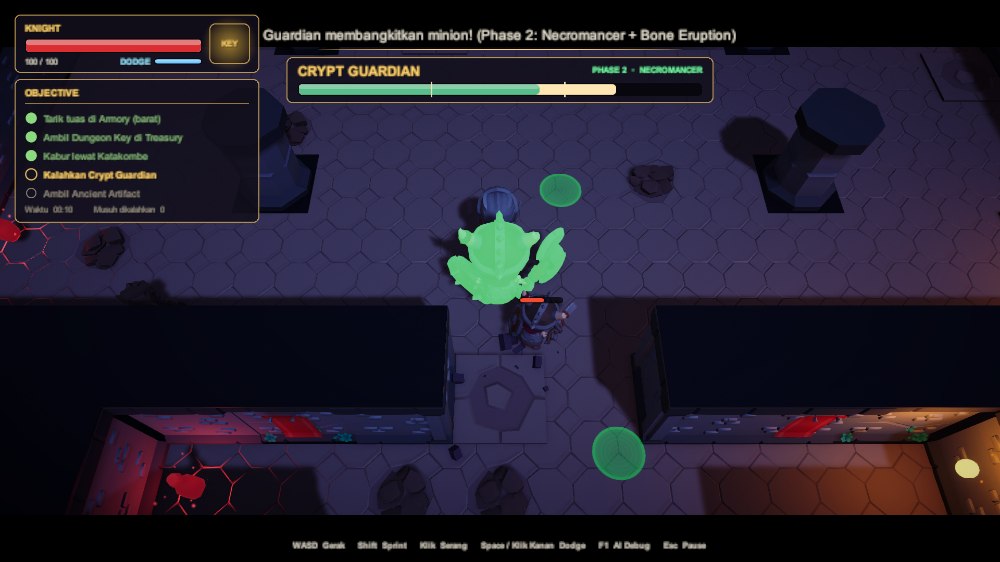
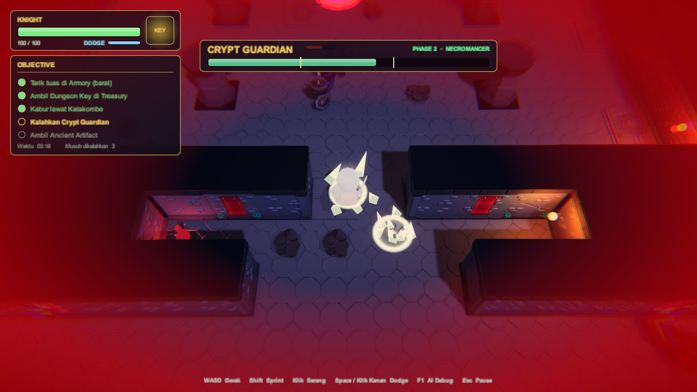
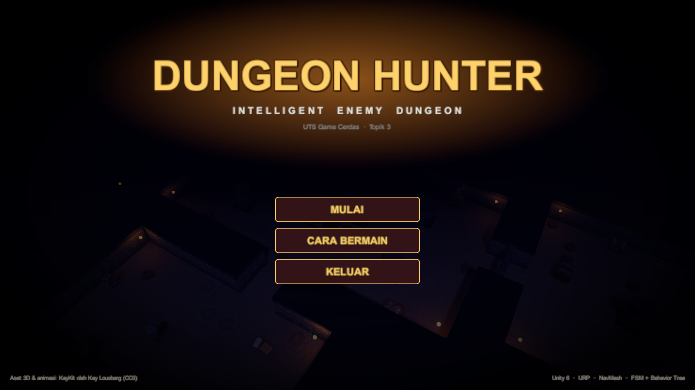
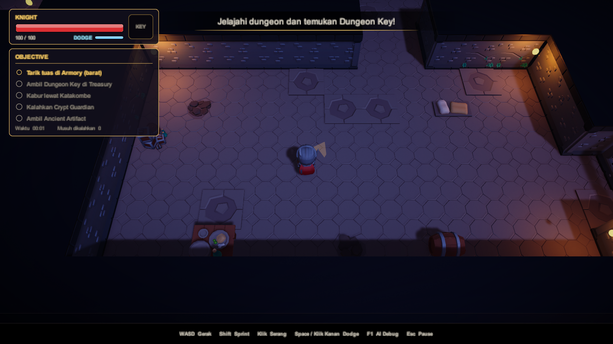
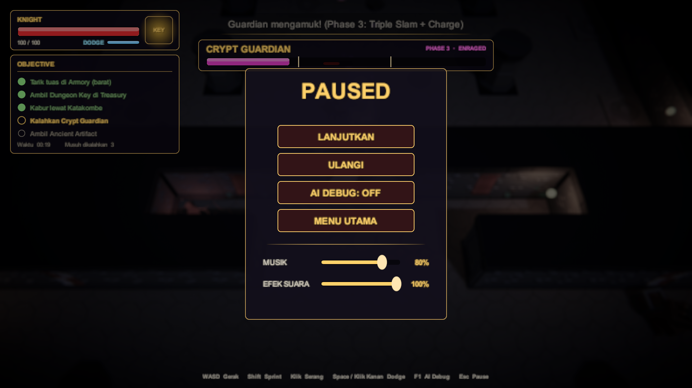
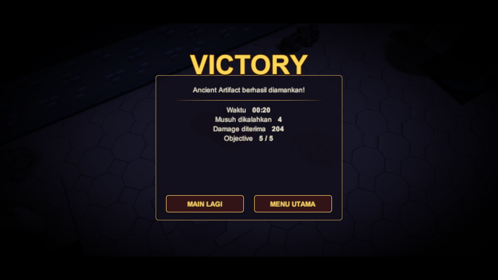

# Penjelasan Kode — Dungeon Hunter (Progress 2)

Dokumen ini menjelaskan kegunaan setiap class dan fitur yang sudah ada.
Semua script berada di `Assets/_DungeonHunter/`.

## Daftar isi

1. [Gambaran arsitektur](#1-gambaran-arsitektur)
2. [Core — sistem dasar game](#2-core--sistem-dasar-game)
3. [Player](#3-player)
4. [AI — inti mata kuliah](#4-ai--inti-mata-kuliah)
5. [Gameplay — objective](#5-gameplay--objective)
6. [DebugTools — AI Debug Mode](#6-debugtools--ai-debug-mode)
7. [VFX — game juice](#vfx--game-juice)
8. [UI — antarmuka](#ui--antarmuka)
9. [Audio — SFX & musik adaptif](#audio--sfx--musik-adaptif)
10. [Editor — pembuat scene](#7-editor--pembuat-scene)
11. [Ringkasan fitur](#8-ringkasan-fitur)

---

## 1. Gambaran arsitektur

Setiap frame, enemy menjalankan urutan berikut:

```text
Perception ──► Memory ──► Decision (FSM / Behavior Tree) ──► Navigation (NavMesh) + Steering (Separation)
```

Hubungan antar class:

```text
EnemyAI (abstract, FSM + Flee + Navigation)
 ├── MeleeEnemy     → Melee AI
 ├── RangedEnemy    → Ranged AI + Maintain Distance ──► Projectile
 └── GuardianEnemy  → Guardian Behavior ──► BehaviorTree (Selector, Sequence, Condition, Action)

EnemyAI memakai: AIPerception, AIMemory, Health, HitFlash, NavMeshAgent

ProximityInteractable (abstract)
 ├── KeyPickup
 ├── LockedDoor
 └── ArtifactPickup

Objek navigasi level: SpikeTrap (Area Cost), Portcullis (dynamic obstacle), NavMeshLink (balkon)
```

Struktur folder:

```text
Assets/_DungeonHunter/
├── Editor/
│   ├── DungeonSceneBuilder.cs
│   ├── AudioImportSettings.cs
│   ├── KayKitImportSettings.cs
│   ├── KayKitVisuals.cs
│   ├── PostFXAssets.cs
│   └── VFXAssets.cs
├── ThirdParty/KayKit/   model, animasi, tekstur KayKit (CC0)
├── ThirdParty/Kenney/   efek suara Kenney (CC0), dimuat lewat Resources
├── Audio/Resources/     musik & ambience prosedural (hasil Tools/AudioGen/generate_music.py)
├── Animation/           Animator Controller (dibuat otomatis oleh builder)
└── Scripts/
    ├── AI/          AIPerception, AIMemory, EnemyAI, MeleeEnemy, RangedEnemy, Projectile,
    │                BehaviorTree, GuardianEnemy
    ├── Core/        Health, NoiseSystem, HitFlash, CharacterAnimator, GameManager
    ├── DebugTools/  AIDebugManager, EnemyDebugVisual, NavigationDebugVisual
    ├── Gameplay/    ProximityInteractable, KeyPickup, LockedDoor, ArtifactPickup, Portcullis, SpikeTrap,
    │                HealthPotion, ObjectivePointer
    ├── UI/          GameUI, UIKit, UIButtonFX, ScreenFader
    ├── Audio/       AudioManager, SoundLibrary, MusicDirector, FootstepAudio
    ├── VFX/         VFXManager, SlashArc, TelegraphLine, DamageFeedback, TorchFX, AmbientSparkles,
    │                DodgeGhost, PostFXController
    └── Player/      PlayerController, PlayerCombat, TopDownCamera
```

Peta level:


| Ruangan | Fungsi |
|---|---|
| **Entrance** (selatan) | Spawn player. Tersambung ke Great Hall; gerbang di sisi timur (jalan pintas Katakombe) tertutup di awal |
| **Great Hall** (pusat) | Persimpangan semua sayap. 2 Skeleton Warrior berpatroli, jebakan duri di tengah, 4 pilar penghalang pandangan |
| **Armory** (barat) | **Tuas 1** ada di atas balkon 1.4 m (naik lewat ramp), dijaga Crossbowman di balkon dan Warrior di bawah. Menarik tuas membuka gerbang Treasury dan berisik → musuh datang memeriksa |
| **Treasury** (timur) | **Dungeon Key** dijaga Skeleton Mage. Begitu Key diambil, gerbang **terbanting menutup** → jalan pulang terputus |
| **Katakombe** (tenggara) | Satu-satunya jalan keluar dari Treasury. Dua lorong: atas pendek tapi berjebakan, bawah memutar tapi aman. Warrior menyergap di crypt; **Tuas 2** membuka jalan pintas ke Entrance |
| **Vestibule** | Ruang kecil sebelum pintu Sanctum, ada Health Potion |
| **Sanctum Guardian** (utara) | Arena Crypt Guardian dengan 4 pilar — berguna untuk berlindung dari Charge. Artifact di ujung utara |

---

## 2. Core — sistem dasar game

### `Health`
`Scripts/Core/Health.cs`

Menyimpan HP. Dipakai oleh player dan enemy.

- `TakeDamage(jumlah, posisiSumber)` dan `Heal(jumlah)`
- Event `Damaged` dan `Died`, supaya class lain bisa bereaksi saat kena damage atau mati
- `Invulnerable` (i-frame saat dodge): damage dibatalkan dan memicu event `Evaded`; event `Healed` saat HP pulih

### `NoiseSystem`
`Scripts/Core/NoiseSystem.cs`

Sistem suara untuk AI pendengaran (Hearing).

- Player memancarkan suara berupa posisi dan radius lewat `NoiseSystem.Emit(...)`
- Enemy yang berada di dalam radius itu akan "mendengar"

### `HitFlash`
`Scripts/Core/HitFlash.cs`

Feedback visual dengan mengubah warna badan sementara.

- Putih saat kena damage
- Dipakai juga sebagai tanda serangan enemy: **kuning** saat melee ancang-ancang, **oranye** saat archer membidik
- Memakai tint `_BaseColor` + `_EmissionColor`, supaya tetap terlihat pada model bertekstur

### `CharacterAnimator`
`Scripts/Core/CharacterAnimator.cs`

Penghubung antara logika (AI / player) dan Animator model KayKit.

| Parameter Animator | Sumber |
|---|---|
| `Speed` | Dihitung dari perpindahan posisi tiap frame → blend idle / jalan / lari |
| `Attack` | `PlayerCombat`, `MeleeEnemy` (saat windup), `RangedEnemy` (saat membidik), Guardian (Slam) |
| `Attack2` | Guardian (windup Charge) |
| `Taunt` | Guardian (summon minion / Enrage) |
| `Hit` | Otomatis dari event `Health.Damaged` (Guardian tidak bereaksi agar serangannya tidak terputus) |
| `Dead` | Otomatis dari event `Health.Died` |

Karena kecepatan diambil dari perpindahan posisi, animasi tetap benar untuk NavMeshAgent,
CharacterController, lompatan NavMeshLink, maupun Charge Guardian.

### `GameManager`
`Scripts/Core/GameManager.cs`

Mengatur alur game.

- Status game: `Menu`, `Playing`, `Paused`, `Won`, `Lost`; setiap perubahan dikirim lewat event `StateChanged` (didengar UI)
- `StartGame()`, `Pause()`, `Resume()`, `Restart()`, `Quit()` — dipanggil tombol UI; **Esc** untuk pause
- Saat `Paused`, `VFXManager` membuat `Time.timeScale = 0` sehingga AI, fisika, dan animasi berhenti
- Progres objective (`ObjectiveStep` 0–5): tuas Armory → Key → tuas Katakombe (kabur) → Guardian kalah → Artifact; event tuas lewat `NotifyLeverPulled`
- Event `KeyCollected` (dipakai gerbang besi untuk menutup)
- Teks objective dan pesan di layar, jumlah kill, timer, total damage yang diterima
- Tombol **R** untuk restart setelah menang atau kalah (langsung main, tanpa main menu)

---

## 3. Player

### `PlayerController`
`Scripts/Player/PlayerController.cs`

- **WASD** untuk bergerak, **Shift** untuk sprint
- Karakter menghadap ke arah mouse
- Langkah kaki memancarkan suara:

| Gerakan | Radius suara |
|---|---|
| Jalan | 2.5 m |
| Sprint | 8 m |

Akibatnya, sprint lebih mudah ketahuan enemy.

**Dodge** (Space / klik kanan):

- Menerjang ke arah input WASD (atau arah hadap) selama 0.28 detik, cepat di awal lalu melambat
- **Kebal 0.32 detik** (`Health.Invulnerable`), cooldown 0.75 detik
- Serangan yang lolos karena i-frame memunculkan **DODGE!**; serangan besar (≥ 20 damage) memunculkan **PERFECT DODGE!** + slow-motion singkat
- Bayangan *afterimage* (`DodgeGhost`) dan noise kecil (radius 4 m)

### `PlayerCombat`
`Scripts/Player/PlayerCombat.cs`

- Serangan pedang dengan **klik kiri** atau **J** (Space dipakai untuk dodge)
- Mengenai semua enemy dalam busur **120°** di depan, jangkauan **2.3 m**, damage **25**
- Ada animasi ayunan pedang
- Setiap serangan memancarkan suara (radius 9 m)

### `TopDownCamera`
`Scripts/Player/TopDownCamera.cs`

Kamera dari atas yang mengikuti player.

- Camera shake berbasis *trauma* (`TopDownCamera.Shake`)
- Saat main menu, kamera mengorbit perlahan di atas dungeon, lalu transisi halus ke player saat **MULAI**
- **Momen sinematik** `TopDownCamera.Focus(titik, durasi, zoom, geser)`: dipakai saat pintu Guardian dibuka (menyorot Guardian),
  Enrage, Guardian kalah, dan mengambil Key. Selama momen ini UI menampilkan *letterbox*
- Saat menang / kalah kamera zoom ke player dan berputar perlahan

---

## 4. AI

### `AIPerception`
`Scripts/AI/AIPerception.cs`

"Sense" dari enemy.

**Penglihatan** dicek bertahap:

```text
1. Jarak     → apakah player di dalam view radius?
2. FOV       → apakah player di dalam sudut pandang?
3. Line of Sight → raycast, apakah terhalang dinding?
```

- Enemy lain tidak menghalangi pandangan

**Pendengaran**: menerima suara dari `NoiseSystem`.

### `AIMemory`
`Scripts/AI/AIMemory.cs`

Ingatan enemy.

- **Last Known Position** (posisi terakhir player yang diketahui)
- Kapan terakhir melihat player
- Sumber info: `Vision`, `Hearing`, atau `Damage`
- Ingatan otomatis hilang setelah 12 detik tanpa update

### `EnemyAI`
`Scripts/AI/EnemyAI.cs`

Class dasar (abstract) semua enemy, berupa **Finite State Machine**.

**State:**

| State | Arti |
|---|---|
| `Patrol` | Patroli waypoint. Kalau tidak punya waypoint, berjaga di pos sambil menoleh kiri-kanan |
| `Investigate` | Berjalan ke Last Known Position / sumber suara |
| `Search` | Mencari di titik-titik acak sekitar Last Known Position |
| `Chase` | Mengejar player yang terlihat |
| `Attack` | Menyerang |
| `Reposition` | Mundur untuk menjaga jarak |
| `Flee` | Kabur ke Retreat Point saat HP rendah, lalu regen |
| `Guard`, `Return`, `Summon`, `Enrage`, `Charge` | Khusus Guardian (diatur Behavior Tree) |
| `Dead` | Badan jatuh lalu dinonaktifkan |

**Perilaku umum:**

- Kalau diserang dari belakang, enemy langsung memeriksa arah datangnya serangan
- **Steering Separation**: enemy saling menjauh supaya tidak bertumpuk
- Menyimpan data untuk debug: State, `Reason` (alasan keputusan), tujuan gerak, dan path

**Flee / Retreat** (Melee & Ranged):

- Terpicu sekali saat HP ≤ **30%**, dari state apa pun
- Retreat Point dipilih berdasarkan **panjang path NavMesh** (bukan garis lurus): titik dianggap aman kalau path enemy ke sana lebih pendek daripada path player, lalu dipilih yang paling jauh dari player
- Sampai di titik aman → diam, menghadap player, regen **8 HP/detik**
- HP ≥ **70%** → kembali memburu (Investigate) kalau masih ingat LKP, kalau tidak → Patrol
- **Terpojok** (player < 2.2 m) → berhenti kabur dan melawan balik

**Navigation:**

| Fitur | Cara kerja |
|---|---|
| Area Cost | `agent.SetAreaCost(Trap, trapAreaCost)` per enemy: Melee 5, Archer 8, Guardian 1. Pathfinding menghindari jebakan selama jalan memutar lebih murah |
| NavMeshLink | `autoTraverseOffMeshLink = false`; saat agent tiba di link, enemy melompat sendiri dengan lintasan **parabola** lalu `CompleteOffMeshLink()` |
| Partial path | `pathStatus == PathPartial` → tujuan tidak bisa dicapai: berjalan ke ujung path (titik terdekat), menunggu 2 detik sambil menghadap tujuan, lalu Search |
| Panjang path | `PathLength(from, to)` menghitung panjang path NavMesh memakai area cost enemy tersebut (dipakai Flee) |
| Repath | Saat NavMesh berubah (gerbang menutup), NavMeshAgent otomatis menghitung ulang jalur |

### `MeleeEnemy`
`Scripts/AI/MeleeEnemy.cs`

**Melee AI** - Skeleton Warrior (×2).

- Mengejar player sampai jarak **1.8 m**, lalu menyerang
- Ancang-ancang **0.35 detik** (berkedip kuning) sebelum memukul
- Damage hanya masuk kalau player masih di depan dan masih dalam jangkauan, jadi serangannya bisa dihindari

FSM Melee:


### `RangedEnemy`
`Scripts/AI/RangedEnemy.cs`

**Ranged AI + Maintain Distance** - Skeleton Crossbowman (berjaga di balkon) dan Skeleton Mage.

Perilaku berdasarkan jarak ke player:

| Jarak ke player | State | Perilaku |
|---|---|---|
| > 9 m | `Chase` | Mendekat |
| 5–9 m | `Attack` | Berhenti, membidik 0.45 detik, lalu menembak |
| < 5 m | `Reposition` | Mundur sambil tetap menghadap player |

Cara memilih posisi mundur:

- Mengevaluasi **7 arah × 2 jarak langkah** di NavMesh
- Memilih titik yang paling jauh dari player dan bisa dicapai
- Sudut menyamping membuat archer bisa bergeser menyusuri dinding saat di pojok

Kalau tidak ada ruang untuk mundur, archer dianggap **terpojok**: tetap menembak, lalu mencoba mundur lagi setelah 2 detik.

FSM Ranged:


### `Projectile`
`Scripts/AI/Projectile.cs`

Panah / peluru archer.

- Bergerak lurus
- Menembus sesama enemy
- Hancur saat mengenai dinding
- Memberi damage ke player

### `BehaviorTree`
`Scripts/AI/BehaviorTree.cs`

Framework Behavior Tree kecil (materi Pertemuan 6).

| Node | Cara kerja |
|---|---|
| `BTSelector` | Coba child dari kiri ke kanan; berhenti di child pertama yang **Success** atau **Running** |
| `BTSequence` | Jalankan child berurutan; berhenti di child pertama yang tidak **Success** |
| `BTCondition` | Leaf yang mengecek kondisi → Success / Failure |
| `BTAction` | Leaf yang menjalankan perilaku → Success / Failure / Running |

`BTContext` mencatat **jalur node yang aktif** (contoh `Root > Ground Slam > Slam`) untuk ditampilkan di AI Debug Mode.

### `GuardianEnemy`
`Scripts/AI/GuardianEnemy.cs`

**Guardian Behavior** — Crypt Guardian (×1), boss penjaga Artifact. Turunan `EnemyAI`, tapi keputusannya memakai **Behavior Tree** (bukan FSM).


| Summon minion | Bone Eruption (duri di posisi + prediksi player) |
|---|---|
|  |  |

Tiga phase, skill bertambah di setiap phase (HP Guardian 400):

| Phase | HP | Skill |
|---|---|---|
| 1 — Warden | > 66% | Kejar, Ground Slam, **Summon** (hanya jika player kiting) — maks 2 minion |
| 2 — Necromancer | ≤ 66% | + gelombang 3 minion, Summon setiap minion berkurang (maks 3, cooldown 10 s), **Bone Eruption** |
| 3 — Enraged | ≤ 33% | + lebih cepat ×1.4, **Triple Slam**, **Charge**, Bone Eruption 5 titik & lebih cepat |

| Cabang | Kondisi | Aksi |
|---|---|---|
| Phase 2 | HP ≤ 66% dan belum Phase 2 | **Bangkitkan minion**: channel 1.3 detik, lingkaran hijau di titik NavMesh → gelombang minion |
| Phase 3 | HP ≤ 33% dan sudah Phase 2 | **Enrage**: diam 1.2 detik, kecepatan ×1.4, cooldown Slam & Eruption turun |
| Leash | Player keluar arena (> 10 m dari pos) | **Kembali ke pos** + regen 15 HP/detik |
| Summon | Minion < batas phase (2/3/3) **dan** (player *kiting* > 8 m selama 1.5 detik **atau** Phase ≥ 2), cooldown siap | **Bangkitkan minion**. Saat kiting, minion muncul di antara Guardian dan player untuk memotong jalan |
| Ground Slam | Jarak ≤ 2.6 m dan cooldown siap | Windup 0.8 detik → area 3 m, 25 damage. **Phase 3: Triple Slam** — 3 hentakan beruntun, radius ×1.2 tiap hentakan, sambil maju |
| Charge | Phase 3, melihat player, jarak 4.5–10 m, cooldown siap | Windup 0.6 detik → menerjang 0.8 detik, 20 damage |
| Bone Eruption | Phase ≥ 2, **melihat** player, jarak 5–16 m, cooldown 6 detik | Lingkaran di posisi player **sekarang**, posisi **prediksi** (posisi + kecepatan × windup), dan di sampingnya → duri tulang, 18 damage. Player yang bergerak lurus akan kena; berbelok, dodge, atau berlindung di balik pilar (memutus line of sight) |
| Kejar | Player / LKP berada di dalam arena | Kejar player atau menuju LKP |
| Jaga pos | — (fallback) | Berjaga di pos sambil melihat sekeliling |

- Semua skill bersifat **committed**: sekali mulai, diselesaikan dulu
- **Skeleton Minion** = `MeleeEnemy` biasa (prefab `Prefabs/Skeleton_Minion`, model KayKit `Skeleton_Minion`): HP 25, cepat, tidak kabur.
  Saat muncul langsung masuk **Chase** (`AggroOnSpawn`) dan memakai FSM melee yang sama. Semua minion runtuh saat Guardian kalah
- Perception Guardian 20 m / 200° (mengawasi seluruh arena), tetapi pilar tetap memblokir line of sight
- Bar boss menampilkan phase aktif dan jumlah minion, dengan garis penanda di 66% dan 33%
- `BoneSpikes` (`Scripts/VFX/BoneSpikes.cs`): duri spektral prosedural yang menyembul lalu tenggelam
- Guardian tidak mengejar keluar arena, sehingga player bisa mundur untuk mengatur ulang posisi (tapi Guardian memulihkan HP)
- Area Trap cost 1 → Guardian tidak peduli jebakan

---

## 5. Gameplay

### `ProximityInteractable`
`Scripts/Gameplay/ProximityInteractable.cs`

Class dasar untuk objek yang aktif saat player mendekat (cek jarak, tanpa physics trigger). Juga membuat visualnya melayang dan berputar.

### `KeyPickup`
`Scripts/Gameplay/KeyPickup.cs`

Dungeon Key. Didapat begitu player mendekat.

### `LockedDoor`
`Scripts/Gameplay/LockedDoor.cs`

Pintu ruang Guardian (tempat Artifact).

- Tanpa Key: muncul pesan "Pintu terkunci"
- Dengan Key: pintu turun ke lantai dan NavMesh di situ terbuka (lewat `NavMeshObstacle` carve)
- Membuka pintu menimbulkan suara keras (radius 12 m)

### `ArtifactPickup`
`Scripts/Gameplay/ArtifactPickup.cs`

Ancient Artifact.

- **Tersegel** (lingkaran ungu) selama Guardian masih hidup
- Setelah Guardian kalah → diambil → **WIN**

### `HealthPotion`
`Scripts/Gameplay/HealthPotion.cs`

Botol merah yang memulihkan **35 HP** saat didekati. Tidak diambil jika HP masih penuh.
Ada 3 di peta (karakter `H` di peta ASCII builder).

### `ObjectivePointer`
`Scripts/Gameplay/ObjectivePointer.cs`

Panah emas di lantai sekitar player yang menunjuk objective aktif (tuas Armory → Key → tuas Katakombe → pintu/Guardian → Artifact).
Arahnya diambil dari **tikungan pertama** `NavMesh.CalculatePath`, bukan garis lurus, sehingga panah
menuntun lewat pintu dan koridor. Disembunyikan saat target sudah dekat atau saat duel Guardian.

### `Portcullis`
`Scripts/Gameplay/Portcullis.cs`

Gerbang besi — **dynamic obstacle**. Ada dua:

- **Gerbang Treasury**: mulai tertutup → `Open()` dipanggil tuas Armory → `Close()` otomatis saat Key diambil (event `KeyCollected`)
- **Gerbang jalan pintas**: mulai tertutup → dibuka tuas Katakombe
- Saat tertutup `NavMeshObstacle` (carve) aktif; saat terbuka penuh carve dimatikan
- NavMesh berubah → semua enemy otomatis **repath**; player yang terkunci di Treasury harus kabur lewat Katakombe

### `Lever`
`Scripts/Gameplay/Lever.cs`

Tuas yang membuka gerbang saat didekati: gagang berayun, lampu indikator kuning → hijau, kamera menyorot gerbang.
Menarik tuas memancarkan **noise radius 14 m** — musuh di sekitar akan datang memeriksa (Investigate).

### `SpikeTrap`
`Scripts/Gameplay/SpikeTrap.cs`

Jebakan duri di tengah Great Hall dan di lorong atas Katakombe — **Area Cost**.

- Lantainya ditandai area NavMesh **`Trap`** (cost tinggi) lewat `NavMeshModifierVolume`, sehingga enemy memilih jalan memutar
- Siklus: diam 1.6 detik → peringatan 0.5 detik (duri muncul sedikit) → aktif 0.8 detik
- Saat aktif, melukai **siapa pun** di atasnya (15 damage), player maupun enemy

Alur gameplay:


---

## 6. DebugToolsMode

Tekan **F1** untuk menyalakan/mematikan.

### `AIDebugManager`
`Scripts/DebugTools/AIDebugManager.cs`

Menampilkan panel di atas setiap enemy, berisi:

- Nama dan HP
- **State** dan **Why** (alasan keputusan)
- Target
- **Can See**, beserta alasannya kalau tidak melihat
- Distance
- Destination
- Path (status + panjang path dalam meter)
- Nav: area NavMesh di bawah kaki (`Walkable` / `Trap`) atau `LOMPAT via NavMeshLink`
- Last Known Position beserta sumber infonya
- Saat Flee: Retreat Point yang dipilih beserta perbandingan panjang path enemy vs player
- Khusus Guardian: jalur node **Behavior Tree** yang aktif, Phase, dan jarak Leash

Contoh panel (screenshot dari game, tekan **F1**):


| Baris | Arti |
|---|---|
| `State : INVESTIGATE` | Archer sedang menuju posisi terakhir player |
| `Why : Kehilangan Line of Sight` | Alasan pindah state: player tadi terlihat lalu hilang dari pandangan |
| `Can See : FALSE (luar FOV)` | Player dalam radius pandang, tetapi di luar sudut pandang (FOV) archer |
| `Distance : 3.6` | Jarak ke player 3.6 m |
| `Destination : Last Known Position` | Tujuan gerak NavMesh adalah LKP |
| `Path : ACTIVE (PathComplete)` | Path NavMesh ke tujuan valid dan lengkap |
| `Last Known : (51.1, 25.5) via Hearing` | LKP terakhir diperbarui dari suara langkah player |
| `Range : 5-9m` | Zona Maintain Distance archer |

Ada juga legenda warna di pojok kiri bawah layar.

### `EnemyDebugVisual`
`Scripts/DebugTools/EnemyDebugVisual.cs`

Garis yang terlihat langsung di **Game view** (bukan hanya Scene view):

| Garis | Warna |
|---|---|
| Field of View | Kuning, berubah **merah** saat melihat player |
| Path NavMesh | Cyan |
| Last Known Position | Magenta |
| Attack range melee | Merah |
| Batas jarak 5–9 m archer | Oranye |
| Leash arena Guardian | Ungu |
| Radius Ground Slam | Merah (terang saat windup) |
| Arah Charge Guardian | Oranye tebal |
| Garis ke Retreat Point saat Flee | Hijau |

### `NavigationDebugVisual`
`Scripts/DebugTools/NavigationDebugVisual.cs`

Visual navigasi level (ikut F1):

| Garis | Warna |
|---|---|
| Zona Trap (area cost tinggi) | Kotak merah bersilang |
| NavMeshLink (lompat turun balkon) | Panah putih melengkung |
| Retreat Point | Lingkaran hijau |
| Gerbang besi | Abu-abu (terbuka) / merah (tertutup) |

---

## VFX — game juice

Semua efek dibuat prosedural lewat kode; tidak ada aset VFX dari luar.


### `VFXManager`
`Scripts/VFX/VFXManager.cs`

Pusat semua efek. Delapan ParticleSystem bersama (world space) dipakai ulang lewat `Emit()`,
sehingga efek bisa muncul di posisi mana pun tanpa membuat objek baru.

| Sistem / fungsi | Dipakai untuk |
|---|---|
| `Sparks` | Percikan memanjang saat pukulan, tembakan, duri |
| `Glow` | Kilatan cahaya (impact, moncong senjata, pickup) |
| `Smoke` | Debu / asap (sprint, mendarat, Slam, gerbang, kematian) |
| `Debris` | Pecahan tulang / batu (mesh kubus) yang memantul di lantai |
| `Ring` | Shockwave melingkar di lantai |
| `Telegraph` | Lingkaran peringatan yang membesar selama windup |
| `ChargeUp` | Bola energi saat ranged membidik |
| `Heal` | Partikel hijau saat regen |
| `Slash` / `LineTelegraph` / `Aura` | Busur tebasan, garis jalur Charge, aura Enrage |
| `DamageNumber` / `Alert` / `FloatingLabel` | Angka damage, ikon **! ? !!** di atas kepala, teks besar |
| `HitStop` / `SlowMotion` / `Shake` | Membekukan waktu sesaat, slow-motion, camera shake |

Semua method statis aman dipanggil walaupun VFXManager tidak ada di scene.

### `SlashArc` dan `TelegraphLine`
`Scripts/VFX/SlashArc.cs`, `Scripts/VFX/TelegraphLine.cs`

- `SlashArc`: mesh busur prosedural yang menyapu kiri ke kanan, ujungnya paling terang, lalu memudar
- `TelegraphLine`: garis di lantai yang berdenyut makin cepat menjelang Charge

### `DamageFeedback`
`Scripts/VFX/DamageFeedback.cs`

Dipasang di player dan semua enemy. Mendengarkan event `Health`:

- **Kena damage:** kilatan, percikan searah pukulan, angka damage, camera shake, knockback
- **Mati:** pecahan tulang + asap. Khusus Guardian: cincin besar, slow-motion, label *GUARDIAN DEFEATED*

### `TorchFX` dan `AmbientSparkles`
`Scripts/VFX/TorchFX.cs`, `Scripts/VFX/AmbientSparkles.cs`

- `TorchFX`: intensitas cahaya obor berkedip (Perlin noise), api bergoyang, bara api naik
- `AmbientSparkles`: kilau partikel di sekitar Key dan Artifact

### Camera shake & hit-stop

- `TopDownCamera` memakai model **trauma**: setiap hit menambah trauma (0..1), guncangan = trauma² × noise, lalu meluruh. Pukulan kecil terasa halus, Slam terasa keras
- Hit-stop dan slow-motion mengatur `Time.timeScale` dan selalu kembali ke 1 (sudah dicek di tes otomatis)

### `VFXAssets`
`Editor/VFXAssets.cs`

Membuat tekstur partikel secara prosedural (soft dot, ring, disc telegraph, strip) sebagai PNG,
lalu material partikel additive / alpha blended / debris.

---

## Post-processing

### `PostFXAssets` (Editor) & `PostFXController`
`Editor/PostFXAssets.cs`, `Scripts/VFX/PostFXController.cs`

Volume global URP dengan profile `Settings/DungeonPostFX.asset`: Bloom, Tonemapping ACES, Color Adjustments,
Shadows-Midtones-Highlights (bayangan kebiruan, highlight hangat), Vignette, Film Grain.
`PostFXController` meng-clone profile lalu menganimasikannya:

| Kejadian | Efek |
|---|---|
| Player kena hit | Chromatic aberration + lens distortion sesaat |
| HP < 35% | Warna memudar, vignette lebih pekat |
| Slow-motion | Aberasi + desaturasi |
| Guardian Enrage | Bloom lebih kuat |
| Pause | Latar blur (Depth of Field Gaussian) + abu-abu |
| Menang / kalah | Lebih terang & bloom kuat / perlahan hitam-putih |

### `DodgeGhost`
`Scripts/VFX/DodgeGhost.cs` — pose karakter di-*bake* (`SkinnedMeshRenderer.BakeMesh`) menjadi mesh biru terang yang memudar.

---

## UI — antarmuka

Semua UI dibuat lewat kode saat runtime dengan uGUI. Tidak ada prefab atau gambar UI dari luar.



### `GameUI`
`Scripts/UI/GameUI.cs`

Membangun Canvas (Scale With Screen Size 1920×1080) dan semua layar, lalu menampilkan/menyembunyikannya
berdasarkan `GameManager.StateChanged`. Setiap layar adalah `CanvasGroup` yang di-fade dengan *unscaled time*.

| Layar | Isi |
|---|---|
| Main menu | Judul, tombol **MULAI / CARA BERMAIN / KELUAR**, kredit; kamera mengorbit dungeon di belakang |
| Cara bermain | 3 kolom: kontrol, objective, tips melawan AI |
| HUD | Panel HP (bar + efek *chip* putih yang menyusut pelan), slot Key yang menyala, checklist objective (✓ saat selesai), waktu & kill, baris kontrol |
| Toast | Pesan objective meluncur dari atas lalu memudar |
| Bar boss | Muncul saat pintu terbuka & Guardian bertarung; menampilkan **PHASE 1** / **PHASE 2 · ENRAGED** |
| Bar HP enemy | Bar kecil di atas kepala enemy yang terluka |
| Vignette | Kilatan merah saat kena damage, berdenyut seperti detak jantung saat HP < 30% |
| Pause | **LANJUTKAN**, **ULANGI**, toggle **AI DEBUG**, **MENU UTAMA** |
| Victory / Defeat | Judul "pop" setelah jeda 1.2 detik, statistik (waktu, kill, damage diterima), **MAIN LAGI** / **MENU UTAMA** |

Juga memastikan ada `EventSystem` dengan `InputSystemUIInputModule` (proyek memakai New Input System).

### `UIKit`
`Scripts/UI/UIKit.cs`

Toolkit kecil untuk `GameUI`:

- Palet warna tema *dark fantasy* (emas, merah tua, ungu boss)
- Sprite prosedural: panel bersudut membulat dengan bingkai emas (9-slice), tombol, bar, lingkaran, vignette, glow
- Helper: `NewRect`, `Stretch`, `AddImage`, `AddText`, `MakeButton`, `MakeBar`, `SetBar`

### `ScreenFader`
`Scripts/UI/ScreenFader.cs`

Fade dari hitam saat scene dimulai, dan fade ke hitam (volume suara ikut turun) sebelum `Restart` / kembali ke menu / keluar.
Selama transisi klik diblokir supaya tombol tidak terpencet dua kali.

### `UIButtonFX`
`Scripts/UI/UIButtonFX.cs`

Efek tombol: membesar dan teks memutih saat di-hover, "punch" kecil saat diklik. Tetap jalan saat pause.

| HUD | Pause | Victory |
|---|---|---|
|  |  |  |

---

## Audio — SFX & musik adaptif

### `SoundLibrary`
`Scripts/Audio/SoundLibrary.cs`

- Enum `Sfx` berisi semua efek suara (±50), dan tabel definisinya
- Tiap definisi: beberapa variasi klip, volume, rentang pitch acak, seberapa 3D, jarak terdengar, cooldown
- Volume tiap suara sudah diseimbangkan dari analisis loudness klip, sehingga tidak ada yang terlalu keras/pelan
- Klip diambil acak tanpa mengulang klip yang sama dua kali berturut-turut

### `AudioManager`
`Scripts/Audio/AudioManager.cs`

- `AudioManager.Play(Sfx, posisi)` dipanggil dari kode gameplay, AI, dan UI
- Pool 32 `AudioSource` (tanpa Instantiate/Destroy saat bermain)
- `AudioListener` mengikuti **player** dengan arah kamera, jadi suara musuh di kiri layar terdengar di telinga kiri dan makin jauh makin pelan
- Slow-motion → pitch SFX turun; Pause → SFX gameplay berhenti, suara UI tetap jalan
- Volume Musik & Efek disimpan di `PlayerPrefs` (slider di menu Pause)
- Ambience: tetesan air acak di sekitar player

### `MusicDirector` — musik adaptif
`Scripts/Audio/MusicDirector.cs`

Musik membaca **state AI** setiap frame:

| Kondisi | Mode |
|---|---|
| Ada musuh `Chase` / `Attack` / `Reposition` | **COMBAT** (bertahan 4 detik setelah pengejaran berhenti) |
| Ada musuh `Investigate` / `Search` / `Flee` | **TENSION** |
| Guardian bertarung (pintu terbuka & tidak sedang `Guard`) | **BOSS** |
| Guardian Phase 2 (Necromancer) | **BOSS PHASE 2** (+ lapisan combat) |
| Guardian Phase 3 (Enrage) | **BOSS PHASE 3** |
| Tidak ada yang waspada | **EXPLORE** |

- 4 stem (explore, combat, boss, boss2) bertempo & berakor sama, dimulai di waktu DSP yang sama (`PlayScheduled`) sehingga selalu sinkron; perpindahan mode hanya mengubah volume (crossfade)
- Combat masuk cepat (±1 detik), keluar pelan (±3 detik) agar tidak "putus-sambung"
- Pause → low-pass filter (musik terdengar teredam); slow-motion juga
- Menang / kalah → stem memudar, diganti stinger + jingle
- Mode aktif ditampilkan di panel AI Debug (F1)

### `FootstepAudio`
`Scripts/Audio/FootstepAudio.cs`

Satu langkah setiap *stride* meter yang ditempuh. Makin cepat bergerak, langkah makin rapat dan keras,
sehingga Patrol, Chase, dan Charge Guardian terdengar berbeda.

### Musik prosedural
`Tools/AudioGen/generate_music.py` (Python + numpy/scipy)

Menghasilkan stem musik (drone, pad, lonceng, taiko, bass, brass, choir), stinger victory/defeat, loop api obor,
dan tetesan air. Loop dibuat mulus dengan pemrosesan melingkar (sinyal diulang 3x, diambil bagian tengah).

### `AudioImportSettings`
`Editor/AudioImportSettings.cs` — musik: Vorbis *Compressed In Memory*; SFX: *Decompress On Load* + mono (lebih tepat untuk 3D).

---

## 7. Editor

### `DungeonSceneBuilder`
`Editor/DungeonSceneBuilder.cs`

Membangun seluruh scene otomatis dari peta teks. Jalankan lewat menu **Dungeon Hunter → Build Prototype Scene**.

Yang dibuat:

- Lantai, dinding, balkon 1.4 m + ramp (collider kubus sederhana untuk NavMesh)
- Volume area `Trap`, obor, dan props ber-collider, lalu bake NavMesh
- Visual KayKit: ubin lantai per sel, fasad dinding di setiap sisi yang menghadap lantai, pilar, banner
- NavMeshLink lompat turun dari balkon
- Jebakan duri (grate + duri KayKit), gerbang besi dan pintu (`wall_gated`)
- Player (Knight) dan kamera
- 2 Melee, 2 Ranged, 1 Guardian (model skeleton + senjata), Retreat Point
- Key (model kunci), pintu, Artifact (bersegel, di atas pilar)
- Material dan prefab proyektil (bola sihir untuk Mage, panah untuk Crossbowman)

### `KayKitImportSettings`
`Editor/KayKitImportSettings.cs`

`AssetPostprocessor` yang otomatis mengatur import aset KayKit:

- Karakter & animasi: rig **Generic** (Rig_Medium), avatar dari model sendiri
- Animasi: clip berisi Idle / Walking / Running / Aiming di-loop
- Senjata & dungeon: mesh statis tanpa rig
- Material FBX tidak di-import (material URP dibuat oleh `KayKitVisuals`)

### `KayKitVisuals`
`Editor/KayKitVisuals.cs`

Helper yang dipakai builder:

- Membuat material URP dari tekstur KayKit (knight, skeleton, skeleton Guardian ungu, dungeon)
- Membuat **Animator Controller** per tipe karakter: blend tree `Locomotion` (Speed: idle → jalan → lari), state `Attack`, `Attack2`, `Hit`, `Taunt` (trigger), dan `Death` (bool)
- `AttachCharacter`: memasang model, menyesuaikan tinggi, memasang senjata ke `handslot.r` / `handslot.l`, dan menambahkan `CharacterAnimator`
- `Place`: menaruh model dungeon dengan ukuran target (aset KayKit berskala ±2× grid game)

| Karakter | Model | Senjata | Animasi serang |
|---|---|---|---|
| Player | Knight | Pedang + perisai | `Melee_1H_Attack_Slice_Horizontal` |
| Skeleton Warrior | Skeleton_Warrior | Blade + perisai kecil | `Melee_1H_Attack_Chop` |
| Skeleton Crossbowman | Skeleton_Rogue | Crossbow | `Ranged_1H_Shoot` |
| Skeleton Mage | Skeleton_Mage | Staff | `Ranged_Magic_Shoot` |
| Crypt Guardian | Skeleton_Warrior (3.1 m, ungu) | Kapak + perisai besar | Slam `Melee_2H_Attack_Chop`, Charge `Melee_2H_Attack_Stab`, Enrage `Skeletons_Taunt` |

Legenda peta (1 karakter = 1 kotak 2×2 m):

| Karakter | Arti |
|---|---|
| `#` | Dinding |
| `.` | Lantai |
| `P` | Spawn player |
| `M` | Melee enemy |
| `R` | Skeleton Crossbowman |
| `Q` | Skeleton Mage |
| `G` | Guardian |
| `K` | Dungeon Key |
| `D` | Pintu ruang Guardian |
| `A` | Artifact |
| `w` | Waypoint patroli |
| `S` | Retreat Point (tujuan Flee) |
| `T` | Jebakan duri (area `Trap`) |
| `g` | Gerbang Treasury (dibuka tuas Armory, menutup saat Key diambil) |
| `j` | Gerbang jalan pintas Katakombe → Entrance |
| `V` / `v` | Tuas Armory / tuas Katakombe |
| `H` | Health Potion |
| `L` | Obor / lampu |

Balkon dan ramp didefinisikan lewat konstanta di builder (bukan karakter peta).
Setiap waypoint otomatis menjadi milik Warrior terdekat, sehingga tiap ruangan punya rute patroli sendiri.
Sel `T` yang bersebelahan digabung menjadi satu jebakan (bisa ada beberapa jebakan).

Bentuk dungeon cukup diubah dengan mengedit peta teks di file itu, lalu menjalankan menu tersebut lagi.

---

## 8. Ringkasan fitur

### Gameplay

- Dungeon 7 ruangan yang saling terkunci: Entrance, Great Hall, Armory (balkon + tuas), Treasury (Key), Katakombe (dua lorong + tuas jalan pintas), Vestibule, Sanctum Guardian
- Player bisa bergerak, sprint, menyerang dengan pedang, dan **dodge** (kebal sesaat)
- Health Potion, panah penunjuk objective (mengikuti jalur NavMesh), kamera sinematik, post-processing, transisi fade
- Alur: tuas Armory → Key di Treasury (gerbang menutup) → kabur lewat Katakombe → kalahkan Guardian → ambil Artifact → **WIN**; HP habis → **LOSE**; tekan **R** untuk main lagi
- Main menu, cara bermain, pause (dengan slider volume), layar Victory / Defeat
- Efek suara 3D untuk combat, AI, level, dan UI; musik adaptif yang mengikuti state AI
- HUD (HP, Key, checklist objective, bar boss), toast pesan, dan vignette saat kena damage

### AI (materi Pertemuan 1–7)

| Materi | Implementasi |
|---|---|
| Perception | Jarak, FOV, Line of Sight, pendengaran |
| Memory | Last Known Position, masa kadaluarsa ingatan |
| Decision | FSM (Melee, Ranged) + Behavior Tree (Guardian) |
| Movement | NavMesh + steering separation |
| Navigation | Area Cost, NavMeshLink, dynamic obstacle + repath, partial path, panjang path |
| Tactical | Maintain Distance, Flee/Retreat, Guardian leash |
| Debug | AI Debug Mode (F1): panel teks + garis visual |

### Fokus AI Topik 3

| Poin | Status |
|---|---|
| Melee AI | ✅ Selesai |
| Ranged AI | ✅ Selesai |
| Maintain Distance | ✅ Selesai |
| Flee / Retreat | ✅ Selesai |
| Navigation | ✅ Selesai |
| Guardian Behavior | ✅ Selesai |

### Kontrol

| Input | Aksi |
|---|---|
| WASD | Bergerak |
| Mouse | Arah hadap |
| Klik kiri / J | Serang |
| Space / Klik kanan | Dodge |
| Shift | Sprint (lebih berisik) |
| F1 | AI Debug Mode |
| Esc | Pause / lanjutkan (+ atur volume) |
| R | Main lagi (setelah menang / kalah) |
