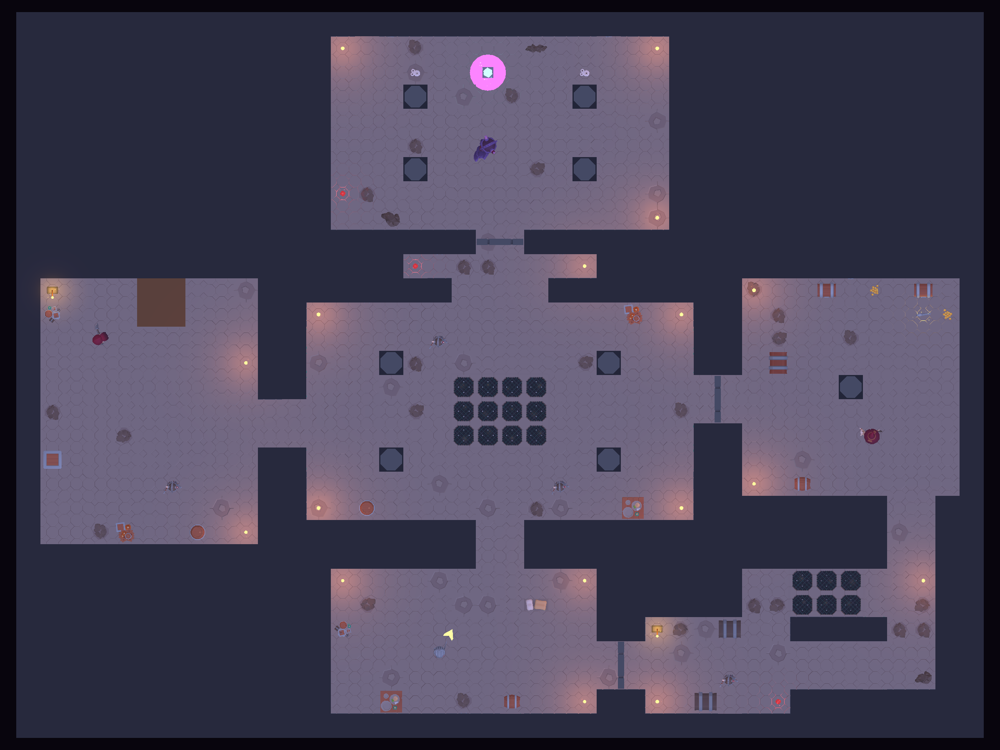
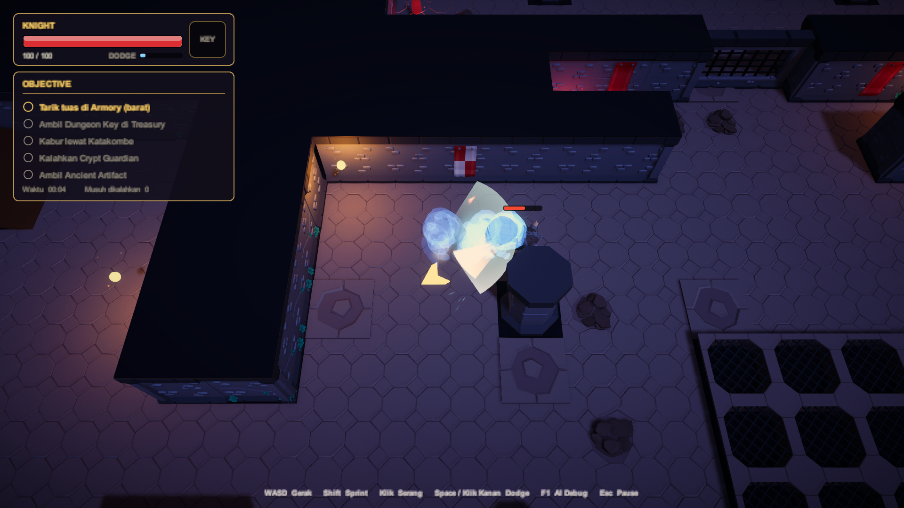
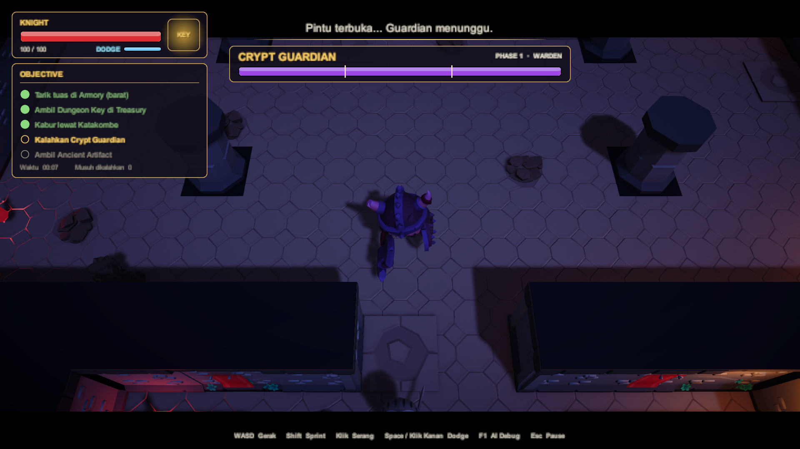
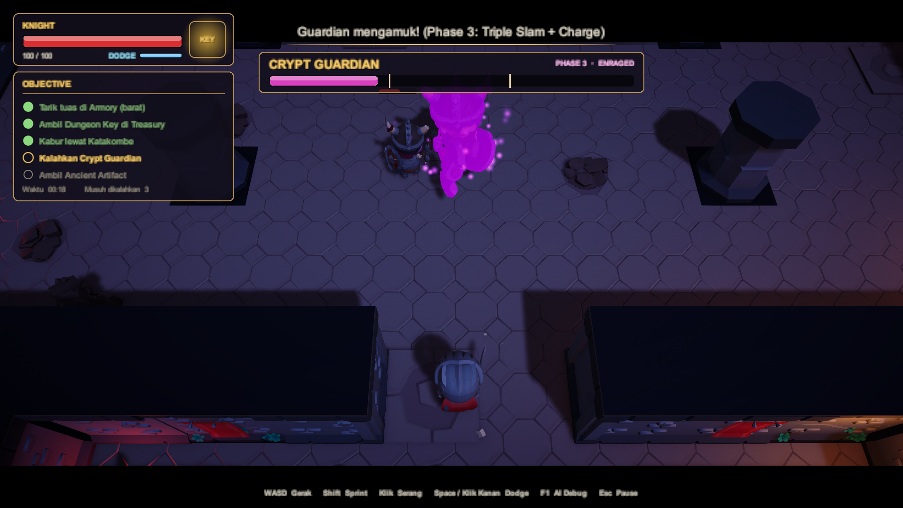
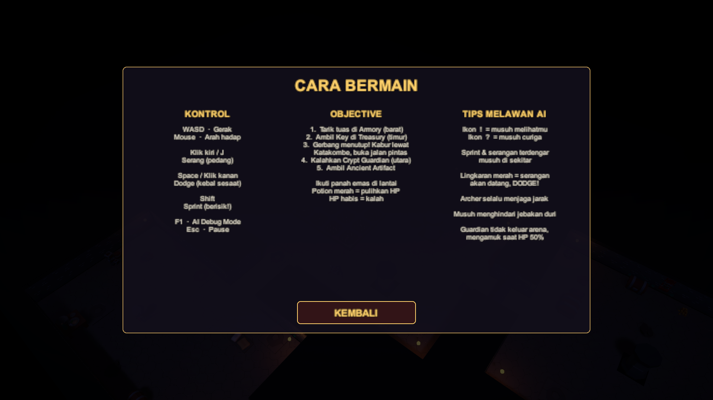
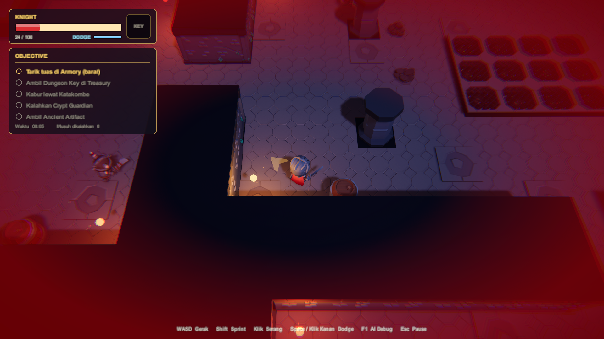
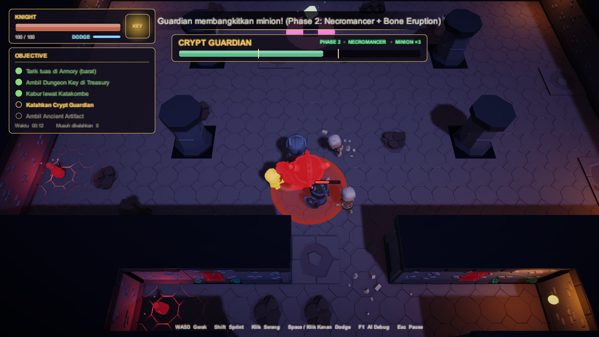
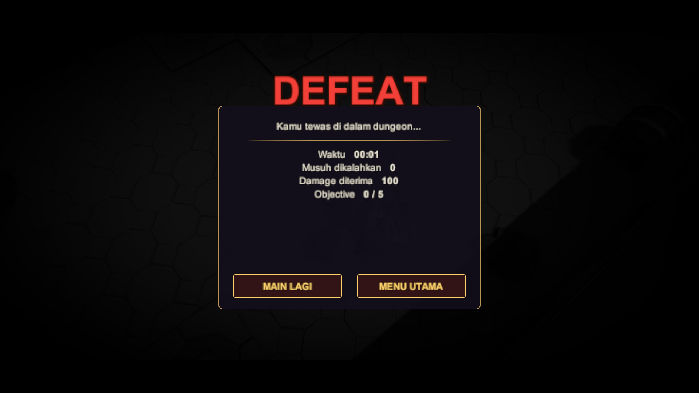

# UTS Game Cerdas — Dungeon Hunter: Intelligent Enemy Dungeon

**Topik 3** · Unity 6000.3.23f1 · URP · AI Navigation (NavMesh) · New Input System

Player menjelajahi dungeon, mencari **Dungeon Key**, membuka pintu ruang Guardian,
mengalahkan **Crypt Guardian**, lalu mengambil **Ancient Artifact**.

> Status: **Progress 2 — seluruh Fokus AI Topik 3 sudah diimplementasikan**
>
> Fokus AI Topik 3: `Melee AI + Ranged AI + Maintain Distance + Flee/Retreat + Navigation + Guardian Behavior`
>
> | Progress 1 | Progress 2 |
> |---|---|
> | ✅ Melee AI | ✅ Flee / Retreat |
> | ✅ Ranged AI | ✅ Navigation (Area Cost, NavMeshLink, Dynamic Obstacle, Partial Path) |
> | ✅ Maintain Distance | ✅ Guardian Behavior (Behavior Tree, 3 Phase + minion) |


*Knight (player), Skeleton Warrior, Skeleton Crossbowman, Skeleton Mage, Crypt Guardian*

## Cara membuka

1. Unity Hub → **Add project from disk** → pilih folder `UTS-DungeonHunter`.
2. Buka scene `Assets/_DungeonHunter/Scenes/DungeonHunter_Progress.unity` → **Play**.
3. Kalau scene belum ada / ingin di-generate ulang: menu **Dungeon Hunter → Build Prototype Scene**.
   Layout level diatur lewat peta ASCII di `Assets/_DungeonHunter/Editor/DungeonSceneBuilder.cs`.

## Dokumen

- [PENJELASAN_KODE.md](PENJELASAN_KODE.md) — penjelasan tiap class & fitur
- `Docs/diagrams/*.drawio` — sumber diagram (buka dengan draw.io), hasil export di `Docs/images/`

## Kontrol

| Input | Aksi |
|---|---|
| WASD | Bergerak |
| Mouse | Arah hadap |
| Klik kiri / J | Serang (pedang) |
| **Space / Klik kanan** | **Dodge** — menerjang cepat, kebal sesaat (i-frame) |
| Shift | Sprint (lebih berisik → terdengar enemy) |
| **F1** | **AI Debug Mode** |
| Esc | Pause / lanjutkan (volume Musik & Efek diatur di menu Pause) |
| R | Main lagi (setelah menang / kalah) |

## Gameplay loop


## Peta & ruangan


Setiap ruangan wajib dilewati — progres dikunci oleh tuas, gerbang, dan Key:

| Ruangan | Fungsi |
|---|---|
| **Entrance** (selatan) | Spawn player. Tersambung ke Great Hall; gerbang di sisi timur (jalan pintas Katakombe) tertutup di awal |
| **Great Hall** (pusat) | Persimpangan semua sayap. 2 Skeleton Warrior berpatroli, jebakan duri di tengah, 4 pilar penghalang pandangan |
| **Armory** (barat) | **Tuas 1** ada di atas balkon 1.4 m (naik lewat ramp), dijaga Crossbowman di balkon dan Warrior di bawah. Menarik tuas membuka gerbang Treasury dan berisik → musuh datang memeriksa |
| **Treasury** (timur) | **Dungeon Key** dijaga Skeleton Mage. Begitu Key diambil, gerbang **terbanting menutup** → jalan pulang terputus |
| **Katakombe** (tenggara) | Satu-satunya jalan keluar dari Treasury. Dua lorong: atas pendek tapi berjebakan, bawah memutar tapi aman. Warrior menyergap di crypt; **Tuas 2** membuka jalan pintas ke Entrance |
| **Vestibule** | Ruang kecil sebelum pintu Sanctum, ada Health Potion |
| **Sanctum Guardian** (utara) | Arena Crypt Guardian dengan 4 pilar — berguna untuk berlindung dari Charge. Artifact di ujung utara |



## Arsitektur AI

```text
Perception ──► Memory ──► Decision (FSM / Behavior Tree) ──► Navigation (NavMesh) + Steering (Separation)
```

| Materi | Implementasi | File |
|---|---|---|
| Perception | Distance + FOV + Line of Sight (raycast) + close awareness + **Hearing** (noise langkah/serangan) | `AI/AIPerception.cs`, `Core/NoiseSystem.cs` |
| Memory | Last Known Position, Last Seen Time, sumber info (Vision/Hearing/Damage), kadaluarsa | `AI/AIMemory.cs` |
| Decision | **FSM** (Melee & Ranged) dan **Behavior Tree** (Guardian) | `AI/EnemyAI.cs`, `AI/BehaviorTree.cs`, `AI/GuardianEnemy.cs` |
| Movement / Steering | NavMeshAgent + **Separation** antar enemy | `AI/EnemyAI.cs` |
| Navigation | NavMesh + **Area Cost** (jebakan), **NavMeshLink** (lompat dari balkon), **dynamic obstacle** (gerbang besi → repath), **Partial Path**, keputusan berbasis **panjang path** | `AI/EnemyAI.cs`, `Gameplay/SpikeTrap.cs`, `Gameplay/Portcullis.cs` |
| Tactical | **Maintain Distance** (archer), **Flee/Retreat** ke titik teraman, **Guardian leash** | `AI/RangedEnemy.cs`, `AI/EnemyAI.cs`, `AI/GuardianEnemy.cs` |

### Tipe enemy

| Enemy | Jumlah | Perilaku |
|---|---|---|
| **Skeleton Warrior** (Melee AI) | 2 | Patroli waypoint → Chase → Attack (windup, bisa dihindari). Kehilangan player → ke Last Known Position → Search → Patrol. HP ≤ 30% → Flee |
| **Skeleton Crossbowman & Skeleton Mage** (Ranged AI) | 2 | Berjaga & look-around → **Maintain Distance** 5–9 m (mendekat / menembak / mundur). Crossbowman berjaga di **balkon**. HP ≤ 30% → Flee |
| **Crypt Guardian** (Guardian Behavior) | 1 | **Behavior Tree**: jaga pos, kejar di dalam arena (leash 10 m), HP 400, 3 phase & 5 skill: Ground Slam, **Summon Minion** (saat player kiting / minion berkurang), **Bone Eruption** (duri di posisi + prediksi player), **Triple Slam**, Charge; kembali ke pos + regen jika player kabur |

### FSM Melee


### FSM Ranged (Maintain Distance)


### Behavior Tree Guardian


| Summon minion | Bone Eruption (duri di posisi + prediksi player) |
|---|---|
|  |  |

## Navigation

| Fitur | Perilaku di game |
|---|---|
| **Area Cost** | Lantai jebakan duri (Great Hall & lorong atas Katakombe) = area NavMesh `Trap` (cost 5; archer 8; guardian 1). Di Katakombe enemy memilih lorong bawah yang memutar (±19 m) daripada lorong atas berjebakan. Duri melukai siapa pun, jadi player bisa memancing enemy |
| **NavMeshLink** | Balkon 1.4 m di Armory (naik lewat ramp). Link satu arah untuk lompat turun; enemy melompat dengan lintasan parabola |
| **Dynamic obstacle** | Dua gerbang besi (`NavMeshObstacle` carve). Gerbang Treasury: tertutup → dibuka tuas Armory (path Entrance→Key berubah dari *Partial* menjadi *Complete* 51 m) → terbanting lagi saat Key diambil. Gerbang jalan pintas dibuka tuas Katakombe. Setiap perubahan → semua enemy repath |
| **Partial path** | Tujuan tidak bisa dicapai (mis. di balik pintu terkunci) → enemy ke titik terdekat, menunggu, lalu mencari |
| **Panjang path** | Flee memilih retreat point yang lebih dulu dicapai enemy daripada player (bukan jarak garis lurus) |

## AI Debug Mode (F1)

Panel di atas setiap enemy: **State, alasan keputusan (Why), Target, Can See (+ alasan
tidak melihat), Distance, Destination, Path (status + panjang), Nav (area di bawah kaki /
sedang lompat NavMeshLink), Last Known Position**, HP, info Retreat saat Flee, dan untuk
Guardian: **jalur node Behavior Tree aktif**, Phase, dan Leash.

Garis di Game view: FOV, path NavMesh, Last Known Position, attack range, maintain distance,
leash & slam Guardian, arah Charge, garis ke Retreat Point, zona Trap, panah NavMeshLink,
Retreat Point, dan status gerbang besi.

## Skenario uji untuk demo

1. **Perception** — F1, berdiri di luar radius / di belakang enemy / di balik pilar → `Can See: FALSE (alasan)`.
2. **Memory** — terlihat Warrior → CHASE, sembunyi di balik pilar → INVESTIGATE ke LKP → SEARCH → PATROL.
3. **Hearing** — sprint di dekat enemy yang membelakangi → INVESTIGATE "Mendengar suara".
4. **Melee AI** — dekati Warrior → ATTACK (windup kuning) lalu menghindar.
5. **Ranged AI + Maintain Distance** — dekati Crossbowman / Mage → REPOSITION, jauhi → CHASE, jarak ideal → ATTACK.
6. **Area Cost** — berdiri di seberang jebakan, path cyan Warrior memutar menghindari kotak merah.
7. **NavMeshLink** — naik ramp ke balkon Armory (tuas), turun, biarkan Warrior mengejar → `Nav : LOMPAT via NavMeshLink`.
8. **Dynamic obstacle** — tarik tuas → gerbang Treasury terbuka, ambil Key → gerbang menutup → path enemy berubah; di Katakombe enemy memilih lorong bawah (Area Cost).
9. **Flee** — pukul Warrior sampai HP ≤ 30% → FLEE ke Retreat Point (garis hijau), regen, kembali.
10. **Guardian** — jaga jarak > 8 m → `Root > Summon` (minion memotong jalan), HP ≤ 66% → gelombang 3 minion + **Bone Eruption** (jangan bergerak lurus, dodge / berlindung di balik pilar), HP ≤ 33% → Enrage → Triple Slam & Charge, keluar arena → Return + regen.
11. **Win / Lose** — kalahkan Guardian → ambil Artifact / biarkan HP habis.

## Progress

**Progress 1**
- [x] Level dungeon playable & NavMesh
- [x] Player controller, melee combat, HP, Win & Lose
- [x] Perception (vision + hearing) & Memory
- [x] FSM decision making + steering separation
- [x] Melee AI, Ranged AI, Maintain Distance
- [x] AI Debug Mode (F1)

**Progress 2**
- [x] **Flee / Retreat** — retreat point berbasis panjang path, regen, terpojok → melawan
- [x] **Navigation** — Area Cost, NavMeshLink, dynamic obstacle + repath, partial path
- [x] **Guardian Behavior** — Behavior Tree 3 phase, 5 skill: Slam, Summon Minion (reaksi terhadap kiting), Bone Eruption (prediksi gerak player), Triple Slam, Charge; leash
- [x] Objective lengkap (5 langkah): tuas Armory → Key → kabur lewat Katakombe → Guardian → Artifact

**Level design**
- [x] Peta 7 ruangan yang saling terkunci: tuas Armory → Key Treasury (gerbang terbanting) → Katakombe (tuas jalan pintas) → Sanctum

**Aset & animasi**
- [x] Karakter KayKit (Knight + 4 skeleton) dengan senjata di slot tangan
- [x] Animator per tipe karakter: idle / jalan / lari, serang, kena hit, mati, taunt
- [x] Environment KayKit: lantai, fasad dinding, pilar, gerbang, jebakan duri, props, banner

**VFX / game juice**
- [x] Hit-stop, camera shake, slow-motion, knockback, angka damage, ikon alert AI (! / ?)
- [x] Telegraph serangan (lingkaran Slam, garis Charge, bola energi Mage), busur tebasan
- [x] Shockwave, debu, puing tulang/batu, aura Enrage, trail proyektil, obor & kilau objective

**UI**
- [x] Main menu (kamera mengorbit dungeon), Cara Bermain, Pause, layar Victory / Defeat dengan statistik
- [x] HUD uGUI: bar HP dengan efek *chip*, slot Key, checklist objective, toast pesan, bar HP boss + fase
- [x] Vignette merah saat kena damage & berdenyut saat HP kritis, bar HP di atas enemy

**Audio**
- [x] ±50 efek suara (Kenney CC0) dengan variasi klip + pitch acak, suara 3D yang didengar dari posisi player
- [x] **Musik adaptif** yang membaca state AI: Explore → Tension → Combat → Boss → Boss Phase 2 → Boss Phase 3
- [x] Ambience obor & tetesan air, musik teredam saat Pause / slow-motion, slider volume

**Polish & game feel**
- [x] Post-processing URP: Bloom, ACES, color grading, vignette, film grain + efek dinamis (hit, HP kritis, pause blur, menang/kalah)
- [x] Transisi fade hitam saat restart / kembali ke menu
- [x] Dodge dengan i-frame, bayangan *afterimage*, dan feedback **DODGE!** / **PERFECT DODGE!**
- [x] Health Potion (3 buah) di peta
- [x] Panah penunjuk objective yang mengikuti **jalur NavMesh**
- [x] Kamera sinematik: intro Guardian, Enrage, Guardian kalah, orbit di layar akhir (+ letterbox)

**Sisa**
- [ ] Video demo

## VFX


Semua VFX dibuat prosedural lewat kode (tanpa aset tambahan). Tekstur partikel di-generate oleh
`Editor/VFXAssets.cs`; efek dipanggil lewat `Scripts/VFX/VFXManager.cs`.

| Momen | Feedback |
|---|---|
| Player menebas | Busur tebasan, hit-stop 60 ms, camera shake, percikan, angka damage, knockback |
| Enemy melihat / mendengar | Ikon **!** (Chase), **?** (Investigate), **!!** (Flee) di atas kepala |
| Melee windup | Lingkaran merah di depan Warrior + busur tebasan merah |
| Mage / Crossbow | Bola energi mengisi saat membidik, kilatan moncong, trail proyektil, ledakan saat kena |
| Guardian Slam | Lingkaran peringatan → shockwave ganda, debu, puing batu, shake besar |
| Guardian Charge | Garis jalur berdenyut → jejak debu, hit-stop saat menabrak |
| Guardian Enrage | Cincin ungu, ledakan cahaya, aura partikel permanen, label *ENRAGED!* |
| Kematian | Pecahan tulang memantul di lantai + asap; Guardian: cincin besar + slow-motion |
| Regen (Flee / Return) | Partikel hijau naik |
| Level | Obor berkedip + bara, debu sprint / mendarat / jebakan / gerbang, kilau Key & Artifact, ledakan pickup |

## Polish & game feel

| Penunjuk objective (jalur NavMesh) | Dodge + afterimage |
|---|---|
|  |  |

| Intro Guardian (kamera sinematik + letterbox) | Phase 3 Enrage (fokus kamera) |
|---|---|
|  |  |

| Fitur | Keterangan |
|---|---|
| Post-processing | Bloom membuat obor, sihir, dan aura Enrage bersinar; tonemapping ACES; bayangan kebiruan & highlight hangat. Dinamis: kena hit → aberasi kromatik + distorsi lensa, HP kritis → warna memudar, Pause → latar blur, kalah → hitam-putih |
| Dodge | Space / klik kanan. Menerjang 0.28 detik, **kebal 0.32 detik**, cooldown 0.75 detik (bar DODGE di HUD). Bisa menembus Slam, Charge, proyektil, dan jebakan |
| Health Potion | 3 botol merah (Vestibule, Katakombe, Sanctum), +35 HP. Tidak diambil kalau HP penuh |
| Penunjuk objective | Panah emas di lantai mengarah ke tikungan pertama hasil `NavMesh.CalculatePath` menuju objective aktif, jadi menuntun lewat pintu & koridor |
| Kamera sinematik | Pintu dibuka → kamera menyorot Guardian; Enrage & Guardian kalah → zoom + fokus; menang/kalah → zoom ke player dan berputar perlahan |
| Fade | Layar memudar ke hitam (suara ikut meredup) sebelum scene di-load ulang |

## Audio

| Momen | Suara |
|---|---|
| Player menebas / kena | Tebasan + whoosh; tulang beradu (skeleton), pelat logam (Guardian), pukulan + armor (player) |
| Langkah kaki | Berbasis jarak tempuh — sprint lebih rapat & keras, skeleton lebih ringan, Guardian berdebum |
| AI berubah state | **!** dentang lonceng (Chase), **?** lonceng lembut (Investigate), **!!** tulang bergemeretak (Flee) |
| Melee / Ranged | Derit tulang saat windup, ayunan; tali crossbow ditarik → lepas; sihir Mage mengisi → tembak → ledakan |
| Guardian | Dengung sebelum Slam → dentuman rendah + bebatuan; derit + gemuruh saat Charge; Enrage = ledakan + gong |
| Kematian | Skeleton runtuh (tulang berjatuhan beruntun), Guardian dentuman + gong + slow-motion (pitch turun) |
| Level | Obor berderak (3D), tetesan air acak, pintu dibuka, rantai + gerbang besi menghantam, jebakan duri klik → hunjam |
| Objective | Gemerincing Key + jingle, segel Artifact pecah, jingle Victory / Defeat |
| UI | Hover & klik tombol, buku dibuka/ditutup saat Pause, halaman dibalik saat pesan objective muncul |

### Musik adaptif (membaca AI)

Musik dibuat prosedural (`Tools/AudioGen/generate_music.py`) sebagai 4 *stem* dengan tempo & akor yang sama
(D minor, 96 BPM), diputar serentak lalu di-crossfade oleh `Scripts/Audio/MusicDirector.cs` sesuai kondisi AI:

| Kondisi AI | Mode | Stem yang terdengar |
|---|---|---|
| Tidak ada musuh waspada | EXPLORE | drone + pad + lonceng |
| Ada musuh **Investigate / Search / Flee** | TENSION | explore + combat pelan |
| Ada musuh **Chase / Attack / Reposition** (+ tahan 4 detik) | COMBAT | taiko + bass ostinato + tremolo |
| Guardian bertarung | BOSS | drum berat + bass distorsi + brass + choir |
| Guardian **Phase 2** (Necromancer) | BOSS PHASE 2 | boss + taiko/ostinato combat |
| Guardian **Phase 3** (Enrage) | BOSS PHASE 3 | boss + hi-hat cepat, roll, disonansi |

Mode musik yang aktif ikut ditampilkan di panel **AI Debug Mode (F1)**.

## UI

| Main menu | Cara bermain |
|---|---|
|  |  |

| HUD | HP kritis |
|---|---|
|  |  |

| Bar boss Phase 2 + jumlah minion (penanda batas phase 66% / 33%) | Pause |
|---|---|
|  |  |

| Victory | Defeat |
|---|---|
|  |  |

Seluruh UI dibangun lewat kode saat runtime (`Scripts/UI/GameUI.cs`) memakai uGUI; sprite panel, tombol,
bar, dan vignette di-generate prosedural oleh `Scripts/UI/UIKit.cs`, jadi tidak ada aset UI tambahan.
Animasi UI (fade, slide, pop) memakai *unscaled time* sehingga tetap jalan saat game di-pause.

## Aset & kredit

Semua aset 3D dan animasi berasal dari **KayKit** oleh Kay Lousberg, lisensi **CC0**
(bebas dipakai, tanpa wajib atribusi). Lisensi asli ada di `Assets/_DungeonHunter/ThirdParty/KayKit/Licenses/`.

| Pack | Dipakai untuk |
|---|---|
| [KayKit Adventurers](https://kaylousberg.itch.io/kaykit-adventurers) | Knight (player), pedang, perisai |
| [KayKit Skeletons](https://kaylousberg.itch.io/kaykit-skeletons) | Skeleton Warrior, Rogue (crossbow), Mage, Guardian (Warrior diperbesar), senjata, panah |
| [KayKit Character Animations](https://kaylousberg.itch.io/kaykit-character-animations) | Animasi Rig_Medium |
| [KayKit Dungeon Remastered](https://kaylousberg.itch.io/kaykit-dungeon-remastered) | Lantai, dinding, pilar, gerbang, jebakan duri, kunci, props, banner |

Efek suara berasal dari paket audio **Kenney** (kenney.nl), lisensi **CC0**:
[RPG Audio](https://kenney.nl/assets/rpg-audio), [Impact Sounds](https://kenney.nl/assets/impact-sounds),
[Interface Sounds](https://kenney.nl/assets/interface-sounds), [Music Jingles](https://kenney.nl/assets/music-jingles),
[Sci-fi Sounds](https://kenney.nl/assets/sci-fi-sounds). Lisensi ada di `Assets/_DungeonHunter/ThirdParty/Kenney/Licenses/`.
Musik latar, stinger, suara obor, dan tetesan air dibuat sendiri secara prosedural.

File zip asli disimpan di `AssetSources/` (tidak di-commit). Hanya file yang dipakai
yang disalin ke `Assets/_DungeonHunter/ThirdParty/KayKit/` dan `ThirdParty/Kenney/`. Pengaturan import otomatis ada di
`Editor/KayKitImportSettings.cs`; pemasangan model, material, dan Animator di `Editor/KayKitVisuals.cs`.

## Pembagian kerja (usulan)

| Anggota | Fokus |
|---|---|
| Anggota 1 | Perception, Memory, FSM, Behavior Tree Guardian, AI Debug Mode |
| Anggota 2 | NavMesh, Area Cost, NavMeshLink, dynamic obstacle, Maintain Distance, Flee |
| Anggota 3 | Player, combat, GameManager, objective, HUD, level & aset |
