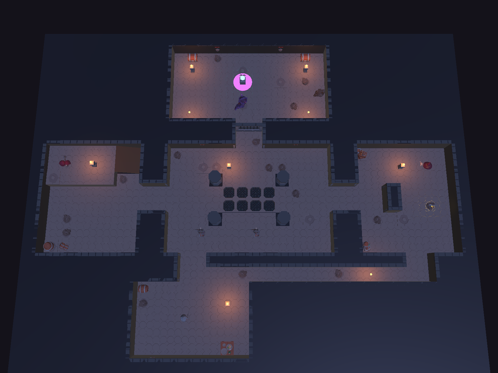
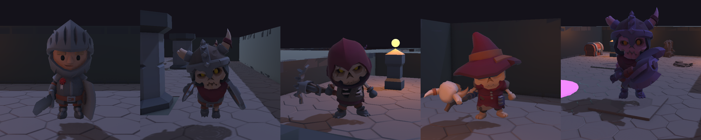
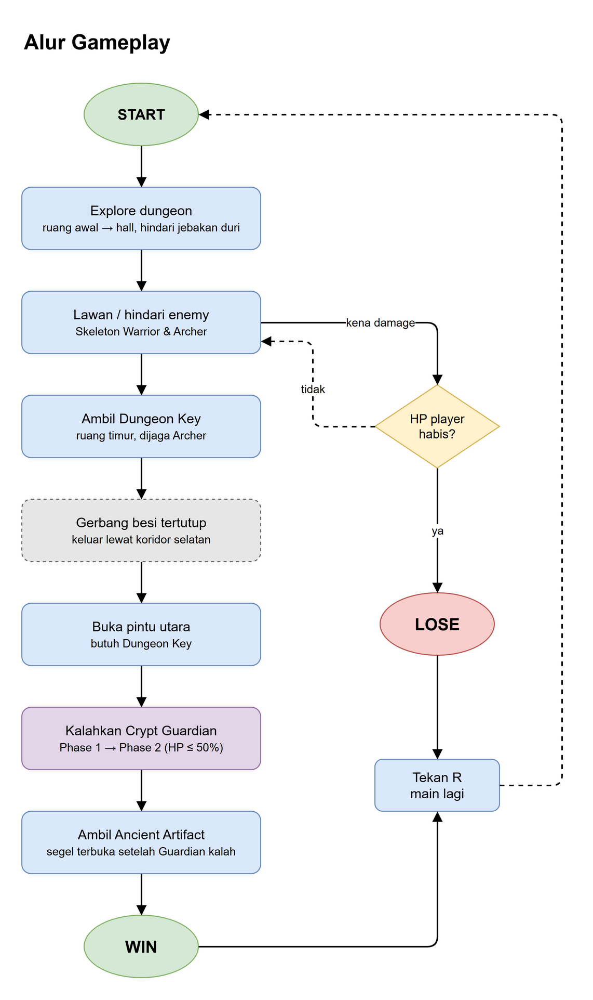
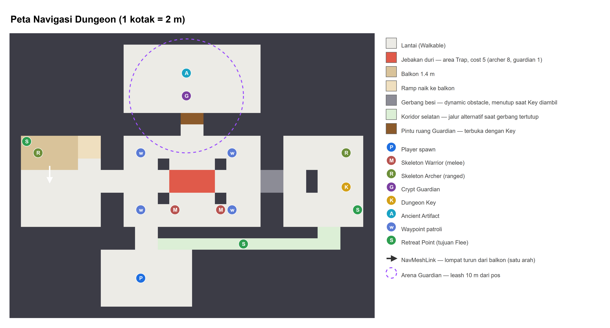
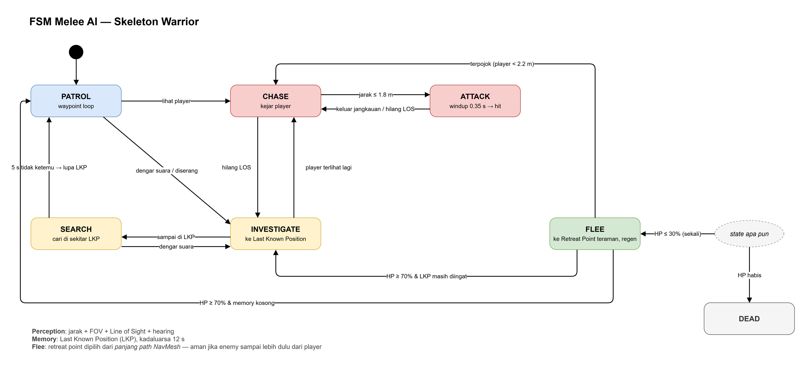
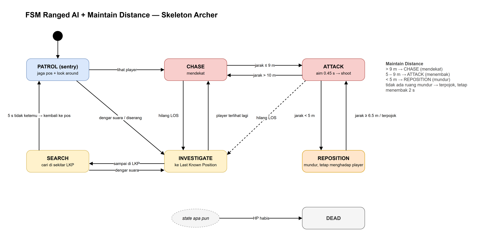
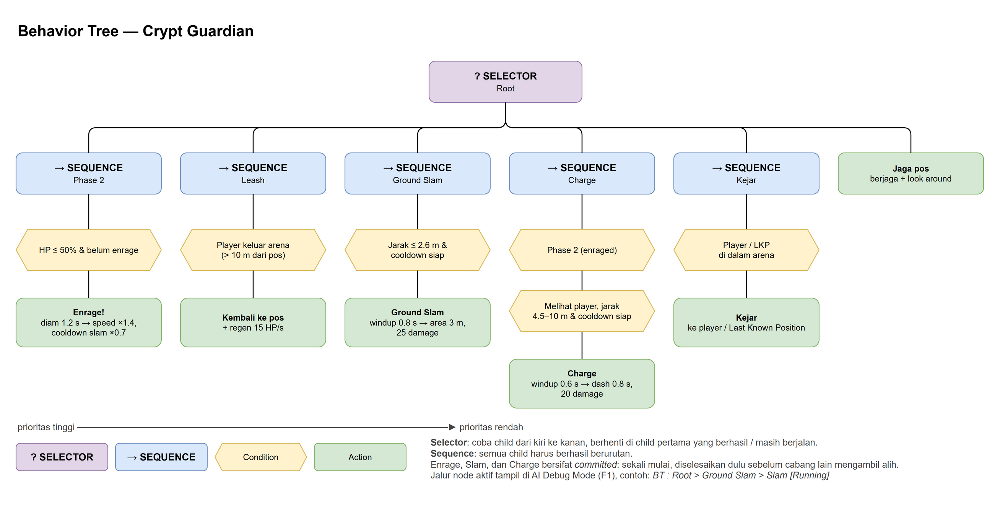
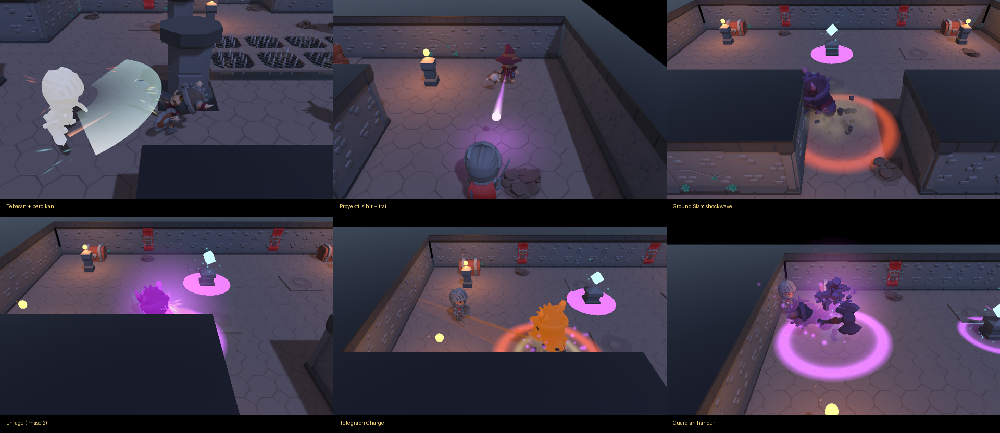

# UTS Game Cerdas — Dungeon Hunter: Intelligent Enemy Dungeon

**Topik 3** · Unity 6000.3.23f1 · URP · AI Navigation (NavMesh) · New Input System

Player menjelajahi dungeon, mencari **Dungeon Key**, membuka pintu ruang Guardian,
mengalahkan **Crypt Guardian**, lalu mengambil **Ancient Artifact**.

> Status: **Progress 2 — seluruh Fokus AI Topik 3 sudah diimplementasikan**
>
> Fokus AI Topik 3: `Melee AI + Ranged AI + Maintain Distance + Flee/Retreat + Navigation + Guardian Behavior`
>
> | Progress 1 | Progress 2 |
> |---|---|
> | ✅ Melee AI | ✅ Flee / Retreat |
> | ✅ Ranged AI | ✅ Navigation (Area Cost, NavMeshLink, Dynamic Obstacle, Partial Path) |
> | ✅ Maintain Distance | ✅ Guardian Behavior (Behavior Tree, Phase 2) |





*Knight (player), Skeleton Warrior, Skeleton Crossbowman, Skeleton Mage, Crypt Guardian*

## Cara membuka

1. Unity Hub → **Add project from disk** → pilih folder `UTS-DungeonHunter`.
2. Buka scene `Assets/_DungeonHunter/Scenes/DungeonHunter_Progress.unity` → **Play**.
3. Kalau scene belum ada / ingin di-generate ulang: menu **Dungeon Hunter → Build Prototype Scene**.
   Layout level diatur lewat peta ASCII di `Assets/_DungeonHunter/Editor/DungeonSceneBuilder.cs`.

## Dokumen

- [PENJELASAN_KODE.md](PENJELASAN_KODE.md) — penjelasan tiap class & fitur
- `Docs/diagrams/*.drawio` — sumber diagram (buka dengan draw.io), hasil export di `Docs/images/`

## Kontrol

| Input | Aksi |
|---|---|
| WASD | Bergerak |
| Mouse | Arah hadap |
| Klik kiri / Space | Serang (pedang) |
| Shift | Sprint (lebih berisik → terdengar enemy) |
| **F1** | **AI Debug Mode** |
| R | Main lagi (setelah menang / kalah) |

## Gameplay loop



## Peta navigasi



## Arsitektur AI

```text
Perception ──► Memory ──► Decision (FSM / Behavior Tree) ──► Navigation (NavMesh) + Steering (Separation)
```

| Materi | Implementasi | File |
|---|---|---|
| Perception | Distance + FOV + Line of Sight (raycast) + close awareness + **Hearing** (noise langkah/serangan) | `AI/AIPerception.cs`, `Core/NoiseSystem.cs` |
| Memory | Last Known Position, Last Seen Time, sumber info (Vision/Hearing/Damage), kadaluarsa | `AI/AIMemory.cs` |
| Decision | **FSM** (Melee & Ranged) dan **Behavior Tree** (Guardian) | `AI/EnemyAI.cs`, `AI/BehaviorTree.cs`, `AI/GuardianEnemy.cs` |
| Movement / Steering | NavMeshAgent + **Separation** antar enemy | `AI/EnemyAI.cs` |
| Navigation | NavMesh + **Area Cost** (jebakan), **NavMeshLink** (lompat dari balkon), **dynamic obstacle** (gerbang besi → repath), **Partial Path**, keputusan berbasis **panjang path** | `AI/EnemyAI.cs`, `Gameplay/SpikeTrap.cs`, `Gameplay/Portcullis.cs` |
| Tactical | **Maintain Distance** (archer), **Flee/Retreat** ke titik teraman, **Guardian leash** | `AI/RangedEnemy.cs`, `AI/EnemyAI.cs`, `AI/GuardianEnemy.cs` |

### Tipe enemy

| Enemy | Jumlah | Perilaku |
|---|---|---|
| **Skeleton Warrior** (Melee AI) | 2 | Patroli waypoint → Chase → Attack (windup, bisa dihindari). Kehilangan player → ke Last Known Position → Search → Patrol. HP ≤ 30% → Flee |
| **Skeleton Crossbowman & Skeleton Mage** (Ranged AI) | 2 | Berjaga & look-around → **Maintain Distance** 5–9 m (mendekat / menembak / mundur). Crossbowman berjaga di **balkon**. HP ≤ 30% → Flee |
| **Crypt Guardian** (Guardian Behavior) | 1 | **Behavior Tree**: jaga pos, kejar di dalam arena (leash 10 m), Ground Slam, Phase 2 (HP ≤ 50%: lebih cepat + Charge), kembali ke pos + regen jika player kabur |

### FSM Melee



### FSM Ranged (Maintain Distance)



### Behavior Tree Guardian



## Navigation

| Fitur | Perilaku di game |
|---|---|
| **Area Cost** | Lantai jebakan duri di tengah hall = area NavMesh `Trap` (cost 5; archer 8; guardian 1). Enemy memilih jalan memutar (path 18 m → 23 m). Duri melukai siapa pun, jadi player bisa memancing enemy |
| **NavMeshLink** | Balkon 1.4 m di ruang barat (naik lewat ramp). Link satu arah untuk lompat turun; enemy melompat dengan lintasan parabola |
| **Dynamic obstacle** | Gerbang besi menutup saat Key diambil (`NavMeshObstacle` carve). Semua enemy otomatis repath lewat koridor selatan (path 19 m → 60 m) |
| **Partial path** | Tujuan tidak bisa dicapai (mis. di balik pintu terkunci) → enemy ke titik terdekat, menunggu, lalu mencari |
| **Panjang path** | Flee memilih retreat point yang lebih dulu dicapai enemy daripada player (bukan jarak garis lurus) |

## AI Debug Mode (F1)

Panel di atas setiap enemy: **State, alasan keputusan (Why), Target, Can See (+ alasan
tidak melihat), Distance, Destination, Path (status + panjang), Nav (area di bawah kaki /
sedang lompat NavMeshLink), Last Known Position**, HP, info Retreat saat Flee, dan untuk
Guardian: **jalur node Behavior Tree aktif**, Phase, dan Leash.

Garis di Game view: FOV, path NavMesh, Last Known Position, attack range, maintain distance,
leash & slam Guardian, arah Charge, garis ke Retreat Point, zona Trap, panah NavMeshLink,
Retreat Point, dan status gerbang besi.

## Skenario uji untuk demo

1. **Perception** — F1, berdiri di luar radius / di belakang enemy / di balik pilar → `Can See: FALSE (alasan)`.
2. **Memory** — terlihat Warrior → CHASE, sembunyi di balik pilar → INVESTIGATE ke LKP → SEARCH → PATROL.
3. **Hearing** — sprint di dekat enemy yang membelakangi → INVESTIGATE "Mendengar suara".
4. **Melee AI** — dekati Warrior → ATTACK (windup kuning) lalu menghindar.
5. **Ranged AI + Maintain Distance** — dekati Archer → REPOSITION, jauhi → CHASE, jarak ideal → ATTACK.
6. **Area Cost** — berdiri di seberang jebakan, path cyan Warrior memutar menghindari kotak merah.
7. **NavMeshLink** — naik ramp ke balkon, turun, biarkan Warrior mengejar → `Nav : LOMPAT via NavMeshLink`.
8. **Dynamic obstacle** — ambil Key → gerbang menutup → path enemy berubah lewat koridor selatan.
9. **Flee** — pukul Warrior sampai HP ≤ 30% → FLEE ke Retreat Point (garis hijau), regen, kembali.
10. **Guardian** — masuk arena → Kejar/Slam, turunkan HP ≤ 50% → Enrage → Charge, keluar arena → Return + regen.
11. **Win / Lose** — kalahkan Guardian → ambil Artifact / biarkan HP habis.

## Progress

**Progress 1**
- [x] Level dungeon playable & NavMesh
- [x] Player controller, melee combat, HP, Win & Lose, HUD
- [x] Perception (vision + hearing) & Memory
- [x] FSM decision making + steering separation
- [x] Melee AI, Ranged AI, Maintain Distance
- [x] AI Debug Mode (F1)

**Progress 2**
- [x] **Flee / Retreat** — retreat point berbasis panjang path, regen, terpojok → melawan
- [x] **Navigation** — Area Cost, NavMeshLink, dynamic obstacle + repath, partial path
- [x] **Guardian Behavior** — Behavior Tree, leash, Ground Slam, Phase 2 (Enrage + Charge)
- [x] Objective lengkap: Key → pintu → Guardian → Artifact

**Aset & animasi**
- [x] Karakter KayKit (Knight + 4 skeleton) dengan senjata di slot tangan
- [x] Animator per tipe karakter: idle / jalan / lari, serang, kena hit, mati, taunt
- [x] Environment KayKit: lantai, fasad dinding, pilar, gerbang, jebakan duri, props, banner

**VFX / game juice**
- [x] Hit-stop, camera shake, slow-motion, knockback, angka damage, ikon alert AI (! / ?)
- [x] Telegraph serangan (lingkaran Slam, garis Charge, bola energi Mage), busur tebasan
- [x] Shockwave, debu, puing tulang/batu, aura Enrage, trail proyektil, obor & kilau objective

**Sisa (polish)**
- [ ] Audio (SFX & ambience), UI final (main menu, HUD uGUI), video demo

## VFX



Semua VFX dibuat prosedural lewat kode (tanpa aset tambahan). Tekstur partikel di-generate oleh
`Editor/VFXAssets.cs`; efek dipanggil lewat `Scripts/VFX/VFXManager.cs`.

| Momen | Feedback |
|---|---|
| Player menebas | Busur tebasan, hit-stop 60 ms, camera shake, percikan, angka damage, knockback |
| Enemy melihat / mendengar | Ikon **!** (Chase), **?** (Investigate), **!!** (Flee) di atas kepala |
| Melee windup | Lingkaran merah di depan Warrior + busur tebasan merah |
| Mage / Crossbow | Bola energi mengisi saat membidik, kilatan moncong, trail proyektil, ledakan saat kena |
| Guardian Slam | Lingkaran peringatan → shockwave ganda, debu, puing batu, shake besar |
| Guardian Charge | Garis jalur berdenyut → jejak debu, hit-stop saat menabrak |
| Guardian Enrage | Cincin ungu, ledakan cahaya, aura partikel permanen, label *ENRAGED!* |
| Kematian | Pecahan tulang memantul di lantai + asap; Guardian: cincin besar + slow-motion |
| Regen (Flee / Return) | Partikel hijau naik |
| Level | Obor berkedip + bara, debu sprint / mendarat / jebakan / gerbang, kilau Key & Artifact, ledakan pickup |

## Aset & kredit

Semua aset 3D dan animasi berasal dari **KayKit** oleh Kay Lousberg, lisensi **CC0**
(bebas dipakai, tanpa wajib atribusi). Lisensi asli ada di `Assets/_DungeonHunter/ThirdParty/KayKit/Licenses/`.

| Pack | Dipakai untuk |
|---|---|
| [KayKit Adventurers](https://kaylousberg.itch.io/kaykit-adventurers) | Knight (player), pedang, perisai |
| [KayKit Skeletons](https://kaylousberg.itch.io/kaykit-skeletons) | Skeleton Warrior, Rogue (crossbow), Mage, Guardian (Warrior diperbesar), senjata, panah |
| [KayKit Character Animations](https://kaylousberg.itch.io/kaykit-character-animations) | Animasi Rig_Medium |
| [KayKit Dungeon Remastered](https://kaylousberg.itch.io/kaykit-dungeon-remastered) | Lantai, dinding, pilar, gerbang, jebakan duri, kunci, props, banner |

File zip asli disimpan di `AssetSources/` (tidak di-commit, ±130 MB). Hanya file yang dipakai
yang disalin ke `Assets/_DungeonHunter/ThirdParty/KayKit/`. Pengaturan import otomatis ada di
`Editor/KayKitImportSettings.cs`; pemasangan model, material, dan Animator di `Editor/KayKitVisuals.cs`.

## Pembagian kerja (usulan)

| Anggota | Fokus |
|---|---|
| Anggota 1 | Perception, Memory, FSM, Behavior Tree Guardian, AI Debug Mode |
| Anggota 2 | NavMesh, Area Cost, NavMeshLink, dynamic obstacle, Maintain Distance, Flee |
| Anggota 3 | Player, combat, GameManager, objective, HUD, level & aset |
